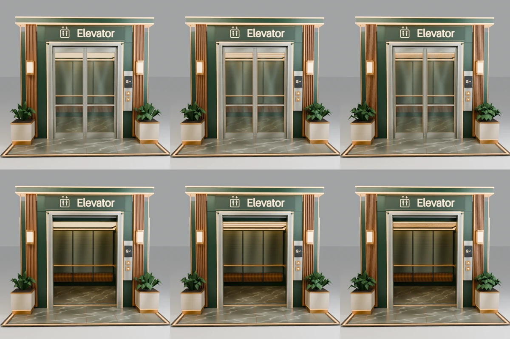

# GJH v11 courtyard elevator

The two landings share a dark green portal, bronze-lit crown, fluted timber pilasters and wall sconces. The opaque brushed-metal leaves meet at a centre seam. When they open, the ceiling diffuser, softly lit rear panels and brass handrail are visible. A mounted lift pictogram and **Elevator** fascia identify the entrance. The right jamb shows the car floor and direction. Two stone planters frame a veined marble apron with a continuous gold inlay.

[Ground-floor phone capture](evidence/gjh-v11-elevator/ground.webp) · [Upper-floor arrival](evidence/gjh-v11-elevator/upper.webp)



## Research and layout

| Source inspected | Finding and design decision |
| --- | --- |
| Owner's `elevator_now.png` and `elevator_ref.png` | The old view looked through a pale arch to a dark flat wall. A second ground-floor label obscured the entrance. The reference uses a rectangular canopy, warm metals, glass that reveals the cabin and a framed marble threshold. The entrance now carries the permanent sign. The localized Ride card remains at the visitor's proximity anchor. |
| `assets/public-architecture.js`, `atrium-layout.js` and `lift-layout.js` | The pale arch belonged to public architecture. Atrium layout owns the surrounding planting and seating. Lift layout owns the west-facing 2 m aperture, 4 × 4 m shaft, car centre (−3, 10), stops at 0 and 7.2 m and exit at (−6.4, 10). The kit replaces the arch at both stops and fits the existing shaft and upper-deck furniture. |
| `assets/elevator-v2.js`, `player.js` and the stage 7 lift notes | The expanded lift already has gates, threshold colliders, an empty-call controller and a kinematic rider. The previous ride comprised 0.45 s boarding, 2.5 s travel and 0.45 s exit. The player still owns motion, admission, interruptions and capsule restoration. The classic profile retains its own centre at (0, 16). [Original floor and recovery contract](gjh-v11-stage7-lift.md) |
| `interaction-registry.js`, `ui.js`, `target-guidance.js` and `mall-language.js` | Both stops use the same `visitor-elevator` ID with different numeric floor anchors. The localized Call/Ride card, its distance, floor gating and map destinations keep their existing owners. Only the redundant projected elevator label is suppressed. Skip uses the existing English, Chinese and Malay localization system. |
| GJH signage kit | The 10 fittings share metre units, +Y up, +Z toward the aisle, fascia proportions and gold/green/timber PBR finishes. Timber slats, brass reveals, emissive letter faces and baked signage inform the new kit. Elevator-specific profiles, pictogram and artwork pack into three sheets shared by both stops. [Signage kit and source receipts](gjh-v11-signage-assets.md) |
| Blender-3D-Gallery | The HDB lift door uses two independent leaves (708 triangles, 11 authored primitives). Its interior has 1,500 triangles and 17 primitives. The passenger lift has 7,652/80, call panel 2,608/16, floor indicator 596/20, wall sconce 6,572/4 and orchid planter 7,912/74. These counts come from the local exports, including placed mesh instances. The new kit adapts the centre seam, recessed glazing, framed diffuser, two-button stack and floor display as original geometry. |

The demo's original architecture still supplies overhead structure, landing slabs and safety guards. The hotel-style car and new architectural finishes use the owner's evergreen palette across seasonal dressing. The existing landing structure keeps its theme hooks. The knowledge lookup returned no project-specific elevator procedure. The routed investigation and verification module files were absent in this worktree, so verification used the project README, current source and executable checks.

## Render budgets

The limit covers **both landings and one travelling car together** in one main colour pass. The pre-existing deck, safety geometry, scene lighting and UI belong to the surrounding mall. Triangle counts include all six expanded door instances. Raw GLB counts below include both named leaves once.

| Tier | Raw kit triangles | Installed triangles / cap | Draws / cap | Textures / cap | GLB bytes |
| --- | ---: | ---: | ---: | --- | ---: |
| Low | 1,676 | 2,340 / 3,000 | 3 / 3 | 3 / 3 at 512² | 269,048 |
| Balanced | 2,144 | 3,000 / 4,000 | 3 / 3 | 3 / 3 at 512² | 308,204 |
| Detailed | 2,748 | 3,772 / 5,400 | 3 / 3 | 3 / 3 at 512² | 364,284 |

Low retains the legible sign, indicator, folded foliage, door seam and cabin. Balanced adds finer fluting, lamp cages, glazing beads, denser planting and ceiling ribs. Detailed adds narrower slats, more leaves, additional ceiling ribs and contrasting steel on the leaf edges. All three tiers add **zero real-time lights**. The three embedded sheets supply sRGB colour/alpha, linear metallic/roughness and sRGB emission. Atlas paint provides warm spill along the inlay and timber even with bloom disabled. [Khronos glTF 2.0 materials](https://registry.khronos.org/glTF/specs/2.0/glTF-2.0.html#materials)

## Asset and renderer contract

One glTF unit is one metre. The origin is at floor level on the centreline of the doorway. +X runs across the doorway, +Y is up and +Z faces the visitor. The car extends along −Z. Expanded rotates the entrance −90° around Y at the west shaft boundary. Classic uses its smaller footprint. The two opaque landings and their indicator faces merge into a single mesh. The car has its own draw. Each stop has one pair of leaves. All four share one instanced draw. In Expanded both doors face west at the threshold. Solid green lacquer panels and brass trim enclose the other three sides. All keep the exported PBR materials. Door transforms and the car position update from the fixed-step simulation. The indicator offsets existing UVs only on a floor/direction change.

| glTF nodes | Purpose |
| --- | --- |
| `Portal`, `Pilasters`, `GoldTrim`, `Sconces`, `Planters`, `ElevatorSign`, `MarbleInlay` | Editable fixed assembly, repeated on each floor |
| `FloorIndicator` | Separate emissive face with four atlas cells for G/1 and up/down |
| `Cabin` | Moving floor, three enclosed walls, mirror panels, handrails and illuminated ceiling. |
| `DoorLeft`, `DoorRight` | Independent transform nodes sharing a mesh at closed local X positions −0.505/+0.505 m. Each slides 1.02 m outward. |

Lift creation immediately requests the active quality GLB so both finished portals are available before the first Ride interaction. The shared upload scheduler prepares the exact merged mesh, car, instanced leaves, textures and shaders before mounting. Fixed-step movement reuses the ride position, collider translations, door matrix and instance buffer. Changing quality retains the current model while its replacement warms. A superseded stage is disposed. An unavailable first asset leaves the functional procedural cabin and original gate colliders available. The gallery generator includes all three GLBs in the publishable directory.

## Ride experience

| Time in seconds | Visible action |
| --- | --- |
| 0.00–0.22 | Source leaves slide open. |
| 0.22–0.55 | The visitor steps through the clear opening into the car. |
| 0.55–0.78 | The source doors close while the car stays at the stop. |
| 0.78–1.36 | The car and visitor travel together with eased acceleration. The indicator follows car height and direction. |
| 1.36–1.58 | The arrival bell sounds and the destination doors open. |
| 1.58–1.84 | The visitor steps out at the existing exit. The capsule and camera return to normal. |
| 1.84–5.00 | The doors hold for egress and close over the final 0.22 s when the doorway is clear. |

**Skip ride** advances the active trip to its destination on the next simulation step. Reduced motion takes the same shortcut automatically. A normal ride takes 111 steps at 60 Hz, or 1.85 s including step quantization. The separate empty Call still requires a subsequent Ride. Leaving the landing cancels an empty call. The existing controls for carts, carried products, seating, map travel and graphics interruption retain their checks.

## Build and verify

Use Python with Pillow 10.1+ for the original atlas art. The checked assets used Pillow 13.0.0, Blender 5.1.2 (ec6e62d40fa9) and Khronos glTF Validator 2.0.0-dev.3.10. The regular gallery build consumes the checked-in GLBs. It requires no Blender or Pillow installation.

```sh
work=$(mktemp -d)
python3 scripts/build_elevator_atlas.py "$work/sheets"
# Set elevator_blender and elevator_guard using the signage build's process-local guard.
BLENDER_USER_RESOURCES="$work/user" DYLD_INSERT_LIBRARIES="$elevator_guard" \
  "$elevator_blender" -b -noaudio --factory-startup --disable-autoexec --python-exit-code 1 \
  --python scripts/build_elevator_kit.py -- "$work/sheets" --source "$work/elevator.blend"
NODE_PATH=/Users/yapweijun/Documents/GitHub/Blender-3D-Gallery/node_modules \
  node scripts/validate_elevator_glb.cjs
python3 scripts/build_gallery.py
python3 scripts/build_gallery.py --check
node --test tests/*.test.mjs
python3 -m unittest discover -s tests -p test_gallery.py
```

The macOS build used a temporary signed copy of the executable from `/Applications/Blender.app`, the installed app's resources and the guard only in the Blender child process. The editable Detailed source and all three byte-identical exports were also copied into the existing detached Blender-3D-Gallery worktree `wBlender/models/gjh-courtyard-elevator/{sources,exports}`. Reopening the source in Blender verified 11 editable nodes, the shared door mesh and all three packed sheets. [Guard build recipe](gjh-v11-signage-assets.md) · [Blender builder](../scripts/build_elevator_kit.py) · [Node contracts](../tests/gjh_elevator_kit.test.mjs)

## Verification and limits

Independent review used both owner screenshots, closed/open renders of all three exports and the expanded mall at 390 × 844 CSS pixels on desktop Chrome with Apple M4 Metal. The first glass treatment hid the rear rail and the marble border blended into the mall floor. Iteration reduced pane opacity, deepened the marble border, widened its emissive core and baked in the warm spill. Final captures show the centre seam, interior rail, mounted icon, display, timber, sconces, two plants and gold inlay. The upper view includes existing deck furniture in the foreground. A separate Classic check revealed raised brass paving over the new ground-floor marble. A 45 mm offset lifts the classic ground apron above the trim. The docked car floor also clears the promenade. Both Classic stops passed a downward-ray clearance test, a visual recheck and a reduced-motion roundtrip. [Classic floor after correction](evidence/gjh-v11-elevator/classic-ground.webp)

In the live Low pass the fixed landings submitted 2,220 triangles, the car 290 and the four leaves 256. Each batch issued one draw. On the observed first ride the whole scene added zero WebGL programs, buffers or textures between boarding and docking. During the preceding walk from the atrium, the scene-wide counters recorded two programs and one texture. Attribution to any specific mesh is unknown. The fixture loaded the selected model before approach and reported zero pending uploads. A trusted Ride click started the 0.52 s two-note Web Audio signal.

All three GLBs passed the Khronos validator with zero errors and warnings. The Node tests inspect the shipped bytes, Three.js imports, draw and triangle counts, named parts, indicator cells, animation endpoints, tier supersession and failure handling. A clean Blender rebuild reproduced all three GLB hashes, and a separate publishable gallery build contained all three byte-identical assets. The gallery freshness check and 15 Python gallery tests passed. The full Node suite passed 228 tests and skipped one optional SVG Studio checkout comparison.

**Unverified** — physical iOS/Android rendering, speaker output and cold HTTP/network frame pacing. The three repository-wide Python browser runners require a listening localhost port, which the sandbox denied. The focused Chrome fixture used the worktree's generated ESM and models with local in-memory resource delivery. Its rendering and interaction checks do not measure HTTP, service-worker behavior or device-level frame pacing. [Final capture identities](evidence/gjh-v11-elevator/evidence.json)
