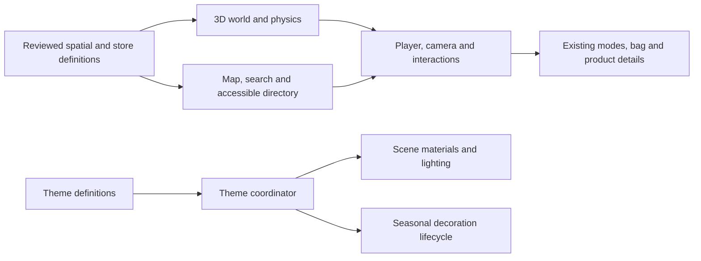

# GJH V11 expanded mall upgrade: master plan

Updated: 15 November 2026 (Asia/Singapore)
Status: **stages 0–5 and 7–10 progressed; stage 11 integration verification and local startup-budget acceptance completed; stage 6 neutral storefront and research slice implemented, with branded candidates pending**. Stage 10 includes Lunar New Year, Christmas and Deepavali. Stage 11b meets the unchanged startup request, decoded-payload and non-cart draw-call assertions at five simulated viewports with limited headroom; see [startup findings](gjh-v11-stage11b-startup.md). The owner liked the proposed 17-store layout and asked for a detailed, sequential upgrade plan. The [stage 3 opt-in ground-floor preview](gjh-v11-stage3-expanded-shell.md) implements the expanded shell, [stage 4](gjh-v11-stage4-atrium.md) adds the atrium and lounges, and [stage 5](gjh-v11-stage5-existing-stores.md) integrates the three existing stores; exact dimensions, future brand rights and real-world construction are not established.

## 1. Product goal and boundaries

Create a believable, warm, modern boutique virtual mall in which a visitor can discover the existing stores and, progressively, additional GJH-related candidate brands. Use the [stage 1 dimensioned plan](references/gjh-mall-floorplan-stage1.png) as the spatial starting point and the [premium interior concept](references/gjh-mall-modern-premium-concept.png) as a visual reference. Both are design inputs, not screenshots of the runtime. The [stage 1 spatial plan](gjh-v11-stage1-spatial-plan.md) owns the current conceptual geometry and area arithmetic; the [earlier brief](gjh-v11-expanded-mall-layout.md) retains the brand-source notes; this document owns the engineering and delivery plan; [task.md](../task.md#expanded-17-store-upgrade--2026-11-15) owns progress.

Keep the three current stores and their relative order, the four existing New Moon product/detail journeys and disclosures, the demo bag, map, touch/keyboard movement, accessible directory, graphics recovery and current unofficial/discovery-only status. Remove the upright central gold ring entirely; use a low planted focal point and a flexible area for removable seasonal displays. The current app is an independent concept, not a real merchant site. No checkout, stock, payment, real orders, account system or claims of brand endorsement are implied.

Outcomes to demonstrate, not assume: a visitor can find a store and reach or inspect it; the mall reads as a coherent human-scale place; theme switching changes a coordinated set of colors/decorations without disrupting the visitor; existing three-store journeys remain usable. Candidate stores with insufficient rights or content must be honestly represented as planned/placeholder, not populated with invented goods. The 70 × 60 m footprint, module sizes, service assumptions and upper landing have now been developed in stage 1; they remain proposals subject to owner review and future actual-scene verification.

## 2. Existing runtime: facts and migration impact

The current [world](../demos/corporate/gjh/v11/assets/world.js) constructs the physical scene with Three.js geometry, a Rapier physics world, three store centers (`newmoon: -10`, `mili: 0`, `gogo: 10`), furniture and scene interactions. The current floor is 30.4 × 29.4 m; the proposed 70 × 60 m floor is a new virtual design, not a real property measurement. [script.js](../demos/corporate/gjh/v11/script.js) derives current zone from three hard-coded x ranges, creates the world/player/elevator, drives the HUD and owns graphics recovery. [player.js](../demos/corporate/gjh/v11/assets/player.js) has named teleport targets, movement, seats and elevator interruption handling. [ui.js](../demos/corporate/gjh/v11/assets/ui.js) and [index.html](../demos/corporate/gjh/v11/index.html) contain the three-store map, zone labels and accessible directory. These are coupled migration points, not an instruction to rewrite them all at once.

The experimental V2 elevator has a small 12 × 10 m upper slab and specific travel behavior; the `visitor=v1` path has different capabilities. The furnishing loader has specific validation and texture/animation constraints documented in the [asset plan](gjh-v11-interior-asset-plan.md). Gallery-generated outputs come from the generator and must not be hand-edited. The [service-worker template](../templates/gallery/sw.js) keeps demos network-only; do not promise full mall offline support by adding heavy 3D assets to precache without a separate reviewed design.

Historical test reports belong to their tested revisions. The prior local V11 run observed 216 draw calls against a 200-call test threshold, but the working tree was changing and that result does not establish a reproducible current baseline. The baseline slice must re-measure and preserve failing evidence; do not raise or weaken the gate to make a new scene pass.

Stage 0 was captured on an identified isolated working-tree snapshot: see the [baseline report](gjh-v11-stage0-baseline.md) for its observations. Its 320px header, V2 seat route and synthetic-gamepad follow-ups were addressed with the limits documented in the [stage 0 fixes report](gjh-v11-stage0-fixes.md).

## 3. Spatial design and geometry contract

The [stage 1 spatial plan](gjh-v11-stage1-spatial-plan.md) and [dimensioned ground/upper diagram](references/gjh-mall-floorplan-stage1.png) now define the proposed 70 × 60 m shell, 17 individual store openings and arrival points, 6 m circulation loop, reservable event/lounge/planting spaces, service-access assumptions and a visitor-only two-level lift. The shared [spatial planning data](references/gjh-mall-spatial-plan.json) drives that diagram and its geometric checker. The plan preserves x/y-to-world conversion `worldX = planX - 35`, `worldZ = 30 - planY`, but does not change the runtime. The implemented expanded shell instead uses `worldX = planX - 25`, `worldZ = 48 - planY`; stage7 anchors follow that runtime transform, as documented in [the lift review](gjh-v11-stage7-lift.md). The 12 × 12 m upper slab and north-boundary reserve openings are conceptual, not proven physical access or regulatory compliance.

Stage 1 verifies its abstract rectangles, area totals, proposed route branches and opening arithmetic. Stage 2 must pilot compatible spatial ownership; stages 3–7 must test real visitor/cart collision and turning, camera sightlines, doors, actual fixtures and both lift landings in the running application. In particular, the existing cart cannot use the lift, and the new shaft and upper slab must be implemented together rather than assumed to match today's lift. Reserve blocks stay non-public unless their service access is independently designed. Brand rights, external service connectivity, walls/frames, real-world egress and owner review remain open.

## 4. Brand, content and storefront plan

The [layout brief](gjh-v11-expanded-mall-layout.md#candidate-brand-allocation-and-evidence) records 17 candidate names: five across the north, six west and six east. The existing eShop and corporate website listings establish that those names appear in those sources, not that GJH owns all marks, currently distributes every brand, or has approved a store. Validate each name, relationship, territory, official artwork, asset rights, product-level facts and last-check date separately. Do not treat the image generator's shop interiors or products as evidence.

Use three content states in the proposed directory and store records:

| State | 3D/store treatment | Directory and interaction |
| --- | --- | --- |
| Existing verified demo | Preserve the current New Moon, MILI or GOGO source-backed experience and its stated limits. | Keep existing stable links, four New Moon SKU identities, accessible alternatives and original official eShop handoff. |
| Planned / content pending | Neutral shell or clearly identified concept placeholder; no unauthorized logo or invented goods. | Show a truthful label and available action; do not imply a functional shop or silently navigate to an empty page. |
| Ready for a supported concept | Use individually reviewed assets and accurate copy within their documented permission and scope. | Add tested store detail and navigation only when content and interaction contracts are ready. |

The 17 positions are planning candidates, not a promise to implement 17 populated catalogs at once. Keep stable IDs distinct from labels and preserve existing `newmoon`, `mili`, `gogo` and `new-moon-...` product IDs unless a compatibility migration is explicitly designed. Do not infer price, stock, health claims, product certification, or official endorsement from listings. Brand verification is a per-store gate; it must not block neutral shells, navigation or other independent stores.

## 5. Proposed ownership and interfaces

Prefer the smallest change that fits the current static application; no new backend or framework is required by this plan. Candidate module names below are responsibilities for future work, not files claimed to exist:

- **Spatial/store definitions:** one authoritative, versioned source of stable store IDs, display order, category, content state, floor, geometry bounds, entrance/arrival anchors and references to independently sourced brand content. Map, labels, zones and teleports derive from the same validated records. Decorative assets and store records do not own physics or UI state.
- **World and physics:** world creation owns visual shell and placements; Rapier owns collision bodies through one explicit integration boundary. Place or remove visual and collision counterparts together. Store asset render and zone detection must not independently guess coordinates.
- **Player and modes:** retain the existing player controller and mode/pause ownership. A destination request checks current readiness and safe transitions before moving; return a result so UI announces success only when movement actually succeeds. Preserve seated/cart/held-product/elevator behavior, focus and camera.
- **Accessible directory and map:** derive labels, filtering, statuses and navigation from the same store records, with non-JavaScript readable content where applicable. A store without an actionable destination must not expose an enabled misleading button. Expanded map text and search need keyboard, touch, focus and localization review.
- **Theme coordinator:** one owner applies a validated theme and manages asynchronous replacement, state, cleanup and notifications; theme data contains color roles, lighting choices and references to optional decoration definitions, not commerce data or physics authority. Existing gallery light/dark preference remains a separate scope unless explicitly integrated.

Stage 2 now pilots shared current-scene store records in [assets/spatial.js](../demos/corporate/gjh/v11/assets/spatial.js); see the [pilot report](gjh-v11-stage2-spatial-pilot.md) for implemented fields, consumers, static fallback and limits. The [stage 3 preview](gjh-v11-stage3-expanded-shell.md) now adds 17 runtime shell slots, with 14 still closed and unbranded.

Proposed expanded-store record contract: `{id, label, category, floor, availability, bounds, arrivalAnchor, contentRef}`. IDs must be unique and stable; finite bounds and valid in-bounds anchors are required; availability controls whether an action is enabled; content references resolve only to locally reviewed records/assets. The expanded-store contract is a design proposal, not a claim that all of these fields or 17 stores are implemented. Define how static HTML and runtime consume it without duplicating business rules or removing no-JS access. Validate empty/duplicate/unknown IDs and stale references before building.

Proposed theme record contract: `{id, label, materialRoles, lightingProfile, decorationRefs}`. Every supported theme resolves known roles and local/allowlisted decoration references; unknown or malformed values fall back to the everyday theme without losing access to the directory. One system owns the active theme and projected state; no scattered theme flags or user-supplied code/asset URLs.

## 6. Theme selection and seasonal lifecycle

Available in the expanded preview: Everyday (forest green/ivory/gold with natural planting), [Lunar New Year](gjh-v11-stage10-lunar-new-year.md) (red/gold, lanterns, kumquat trees and blossoms), [Christmas](gjh-v11-stage10-christmas.md) (evergreen tree, lights and wrapped gifts), and [Deepavali](gjh-v11-stage10-deepavali.md) (jewel tones, warm lamps, floral garlands and a flat rangoli-inspired motif). Keep the upright central ring absent in every theme.

Recommended initial experience is a user-visible, keyboard/touch accessible **Theme** setup in existing mall controls, with the current choice named and selected without relying on color alone. A local browser-only preference is a candidate default, subject to a focused decision about whether the choice is per visitor, session or shared operator configuration; no admin service, login or automatic calendar scheduling is assumed. If storage is blocked, retain a usable in-memory default and explain persistence limits. Never store personal data just to remember a theme.

Define the following before implementation:

1. **Selection:** everyday theme is a safe initial state; announce selection and loading; offer a clear recovery path and maintain focus. A theme only becomes active after its required assets and materials are ready.
2. **Atomic transition:** prepare an incoming set while keeping the previous usable scene; on success replace only the theme-owned decorations/materials. On missing/invalid asset or load failure, dispose the partial set, keep the previous theme or safe everyday fallback and report the result. Optional decoration failure may degrade only when explicitly specified and signalled.
3. **Rapid changes and lifecycle:** use a generation/cancellation rule so late loads cannot override a newer selection; do not duplicate listeners, collision bodies, rendering loops or assets. Dispose owned meshes/materials/textures and their physics proxies once. Manage WebGL context loss, restore, list/3D transition and page close without reviving stale operations.
4. **Visitor state:** preserve bag quantities, position when still safe, store/product/seat/cart state and dialog focus. If switching would introduce collision around the player, prevent/queue it or move only via a documented safe fallback; no silent teleport. Active elevator/held-product transitions need an explicit pause/retry policy.
5. **Quality and fallback:** account for reduced motion, mobile thermal/frame constraints and the existing graphics quality profiles. The accessible directory must remain useful without WebGL, themes, JavaScript or network; seasonal visual props are decorative and do not carry unique essential information.

## 7. Asset, material and performance strategy

For each proposed asset, decide reuse / adapt / author only after a visual and technical review of existing furniture, store shell, kiosk, lighting, product display and pilot candidates. Each accepted asset needs an ID, purpose, source/permission, editable source or provenance, version/hash, units/orientation/bounds, material and texture dependencies, collider and interaction owner, resource size and fallback. Existing eight-asset pilot evidence is historical and does not itself approve a new layout. No invented branded items or automatically downloaded assets.

Prioritize convincing proportions, natural lighting and cohesive compositions before expensive reflections, high-resolution textures or many custom meshes. Evaluate instancing, shared materials, visibility culling, lazy loading and LOD only when measured; avoid adding an asset pipeline or decoder solely for visual ambition. The current texture-free furnishing validator cannot be treated as supporting textured assets. Any material/loader extension needs format/security review, failure and disposal checks and an actual tested browser support matrix.

Measure the same route, viewport, quality tier and environment before and after each material/asset milestone: transferred and decoded bytes, request count, geometry/texture counts, draw calls, triangles, render/interaction timings and repeated theme-switch resource behavior. Use the repository's existing draw-call test limit as a current check; if baseline or candidate fails, document and investigate with comparable evidence rather than silently changing thresholds. Hardware, driver, lab WebGL and thermal observations are separate from physical-device FPS claims. Set any additional budgets after a baseline and explicit product targets exist; no time, cost or performance promises are established here.

## 8. Delivery sequence: one verified slice at a time

Every slice starts from the actual current checkout and preserves unrelated staged, unstaged and untracked work. Snapshot or use an isolated copy for screenshot-writing browser suites; never assume a worktree contains uncommitted changes. For each slice, define the starting evidence, narrowly scoped files, expected behavior, visual references, regression checks, rollback path and result. Keep status in `task.md` and link actual artifacts/receipts. If a prerequisite is unavailable, continue independent design work without fabricating completion.

| Step | Deliverable and dependency | Acceptance evidence before next step |
| --- | --- | --- |
| 0. Baseline | Inventory current concurrent changes, exact source/revision, three-store routes, existing screenshots and test results; record a clean comparison profile. | Reproducible desktop/tablet/mobile baseline, resource budget, current failures and safe test-output destination. No old evidence relabelled as current. |
| 1. Refine spatial plan — documented | Proposed footprint, openings, nominal clearances, 17 slots, reserve boundary openings and aligned two-floor lift. | [Drawing, coordinates and geometric checks](gjh-v11-stage1-spatial-plan.md); owner review and runtime/physical verification remain open. |
| 2. Spatial data pilot — implemented | Shared records drive the existing three store identities, geometry centers, arrival anchors, map and live directory while preserving legacy IDs and the static fallback. | [Pilot report and verification](gjh-v11-stage2-spatial-pilot.md); expanded geometry and its real collision/asset validation remain future work. |
| 3. Expanded shell and circulation — implemented as preview | Reversible ground-floor shell, 14 closed neutral placeholders and 3 existing stores; the original scene remains the default. | [Walking, cart, map, recovery, visuals and local budget observations](gjh-v11-stage3-expanded-shell.md); further interior and physical-device work remain. |
| 4. Atrium and seating — implemented as preview | Low planted bed, two lounges, and an open event reservation; ring and its collider absent from the expanded scene. | [Seat, cart, collision, camera, screen and performance evidence](gjh-v11-stage4-atrium.md); seasonal installations and physical-device checks remain later work. |
| 5. Existing stores — implemented as preview | Integrate New Moon, MILI and GOGO storefronts and directory-to-3D journeys. | [Three-store, four-SKU, bag, map, fallback and PWA evidence](gjh-v11-stage5-existing-stores.md); existing rooms retain their original depths. |
| 6. Candidate storefronts | [Neutral numbered shells, directory and individual evidence review](gjh-v11-stage6-candidate-stores.md) implemented; replace individually only as content/rights clear. | Each record's label, state, destination and content agree; unavailable actions are honest; no invented brand claims or inaccessible dead ends. |
| 7. Elevator and facilities | [Expanded lift, upper landing and truthful facilities reservations](gjh-v11-stage7-lift-facilities.md) implemented locally; preserve visitor-only limits and closed service reserves. | Bidirectional ground/upper travel, collision, camera, interrupted travel/context loss, cart/seat/product interactions and v1 behavior tested. Do not imply a larger upper floor until designed. |
| 8. Materials and lighting | [Local natural finishes and warm lighting](gjh-v11-stage8-materials-lighting.md) in the expanded preview, with optional procedural textures and solid fallback. | Actual entrance, store and walking screenshots at desktop and mobile; material/asset failure fallbacks and matched-profile performance. |
| 9. Theme infrastructure | [Everyday theme, accessible settings and staged lifecycle](gjh-v11-stage9-theme-infrastructure.md) implemented locally; stage 10 builds on that owner. | Fast/repeated switches, storage unavailable, failure, stale completion, context loss, bag/position/focus, cleanup and resource stability verified. |
| 10. Seasonal packs — implemented in preview | [Lunar New Year](gjh-v11-stage10-lunar-new-year.md), [Christmas](gjh-v11-stage10-christmas.md) and [Deepavali](gjh-v11-stage10-deepavali.md) use original removable props; the Deepavali floor motif is flat and non-colliding. | Individual visual and resource evidence, no upright ring, clear movement/camera, optional-asset failure and reversible switching. |
| 11. Integration and startup acceptance — completed locally | [Four-theme integration, accessibility and recovery review](gjh-v11-stage11-integration.md) and [startup budget](gjh-v11-stage11b-startup.md) pass locally. | Keep the unchanged budget gates, monitor their narrow headroom, and retain the physical-device and brand gaps. |

Dependencies are explicit: theme packs need the theme owner (9); that owner needs a stable shell/decor boundary (3–4); new brand content may proceed when its own evidence is ready, without waiting for other brands; facilities and visual styling can be developed independently after the spatial plan but must be reconciled with collision and camera before integration. Earlier steps should not be marked complete merely because a document or concept exists.

## 9. Verification matrix and release evidence

| Surface | Required observations |
| --- | --- |
| Entry and movement | 1440, 768, 639, 390 and 320 CSS-pixel widths as relevant; walk and turn from entry around central features, enter/leave each available store and return; keyboard and real touch where available. |
| Map and directory | Every supported ID has matching name, location, availability and destination; unknown/unavailable records behave explicitly; map focus and keyboard interactions work; complete text remains usable without 3D and without JS. |
| Current commerce demo | Correct four New Moon SKUs, details, image alternatives, links, bag quantities, shelf and physical-product state; MILI/GOGO source-backed artwork; no live price, stock or checkout claim. |
| Seating, cart and elevator | Enter/exit every affected seat; cart routes in both directions; lift approach, travel, both landings, interruption and recovery; no invisible obstacles, accidental overlap or misleading focus. |
| Themes | Every theme and fallback; rapid switching, repeated mount/unmount, missing/invalid assets, blocked storage, reduced motion, WebGL loss/restore, hidden tab and list-to-3D; check position, bag, dialogs, focus and resource stability. |
| Build and regressions | `python scripts/build_gallery.py --check`; `python -m unittest discover -s tests -p test_gallery.py -v`; `python tests/browser_gallery.py`; `python tests/browser_gjh_demos.py`; `python tests/browser_pwa.py`; affected V11, graphics, seat, camera, navigation, product and theme checks. Use required local dependencies/Chrome and a safe isolated copy for screenshot-writing tests. |

Review real screenshots at each visible milestone, including intermediate approach and close-up views; automate geometry and interaction assertions where meaningful. Compare on the same browser/backend/DPR and document runtime errors and performance conditions. Tests using synthetic failure injection prove only those simulated paths. Physical iOS/Android, Safari, screen readers and real inset/thermal behavior require separate actual-device evidence. No claims of passing, official endorsement or complete accessibility follow from a plan or concept image.

Before integration, check the current generated-output state and changes in parallel work. Build from the relevant source, verify the generated result, preserve the existing live-demo/PWA cache boundary and test the generated project subpath. Use a reversible staged preview or equivalent isolation, maintain old routes and three-store content throughout migration, and retain a concrete rollback to the last verified candidate. Do not overwrite unrelated local changes or the user's screenshots. Release/deployment is a separate operational action, not performed by this planning task.

## 10. Risks, decisions and alternatives

| Risk / unknown | Plan |
| --- | --- |
| A substantially larger shell can increase rendering cost and travel distance. | Establish budgets and test a walkable neutral shell early; use spatial loading/instancing only if measurements justify them. |
| The stage 1 plan is conceptual; real wall/door behavior, outside service access and lift safety are not modelled. | Implement and test clearances and both lift landings; retain neutral reserves until independently resolved. |
| Brand lists and rights can change; 17 names do not prove 17 tenants. | Keep per-brand evidence and visible availability; placeholders are independently acceptable. |
| Existing coordinate assumptions, telemetry hooks and tests assume three zones. | Inventory callers and preserve stable IDs; migrate one ownership boundary at a time with compatibility/regression evidence. |
| Theme changes leak resources, collide with a visitor or restore stale content. | Single theme owner, generation-safe staged transitions, collision safety and measured repeated-switch/failure tests. |
| Existing preview, source and screenshots may change concurrently. | Inspect and preserve working state; isolate tests and preview outputs; never overwrite generated assets by hand. |
| Shared operator setup and scheduling are not defined. | The preview currently uses a browser-local preference and on-demand seasonal modules; shared control and scheduled changes need their own design. |

Alternatives: keeping the existing 30 m shell would require shared brand spaces and conflicts with the owner's preference for separate storefronts; the 70 × 60 m shell is a proposed starting point, not an irrevocable requirement. Building all 17 branded interiors at once increases content, rights and performance risk; use neutral shells and a per-store evidence gate. A server-managed theme schedule would add operational and access complexity; start with the existing static app and revisit only when shared configuration is actually needed.

Open decisions for the relevant later slice: owner review and actual-scene clearance validation; external service connectivity beyond the two proposed boundary openings; detailed upper-floor furnishing; exact store priority/content and permissions; whether a shared operator theme setup is needed; and target physical devices and performance thresholds. The preview's Theme control, browser-local preference and on-demand seasonal modules are implemented. No unsupported timing or cost estimate is supplied.
