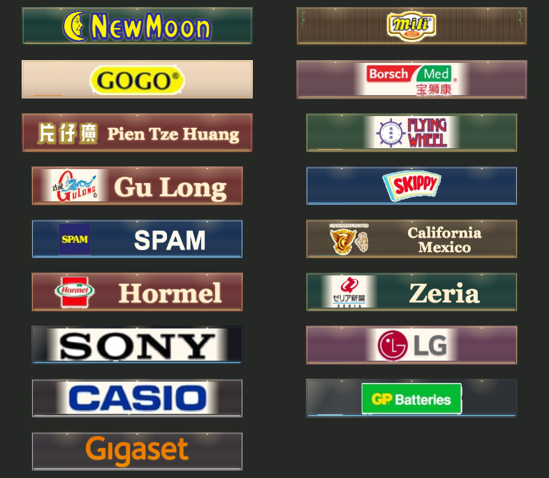

# GJH v11 storefront signage

The expanded mall has one configurable sign for each of its 17 occupied bays. Its fascia, projecting double-faced blade, number plate and lit hero graphic share one colour atlas. The three north anchors keep their HUD-tracked room names. The other fourteen stores also reuse the atlas on their existing product stands and rear brass plaques. The upper-deck story gallery and Classic layout have their own presentation.

The two columns below show the baked fascia faces at the approximate CSS size of a 12 m frontal approach on a 393 px phone. Rows follow slot order, left to right.



## Add a store

1. Use its stable spatial slot, a matching brand-kit entry and a locally sourced hero in `assets/brand-kit/`. Record a found official logo in `assets/brands/logo-sources.json`. `logo: null` selects the store name with the existing Studio door icon as a wayfinding symbol.
2. Add its entry in `assets/signage/config.js`. A minimal entry is `S18: store('t5-book')`. Supply overrides for brand-specific typography or materials. The current atlas has space for 24 slots. Adding a physical destination also uses the mall's existing spatial and directory procedures.
3. Run the signage tests, regenerate the startup bundles and gallery, then check the actual published view. Optional relief and trim assets use the [GLB contract](../demos/corporate/gjh/v11/assets/signage/models/README.md).

Example configuration for an existing bay:

```js
S05: store('heritage-red', {
  caption: true,
  typography: 'heritage',
  lodDistance: 16
})
```

| Config key | Resolution and limits |
| --- | --- |
| Slot, brand | Keyed by the bay ID, e.g. S01. Display name defaults to the local brand-kit name. |
| `logo`, `poster` | Own slot ID or null. Logo paths require a matching found receipt. Missing or undecodable artwork uses a neutral wordmark treatment. |
| `preset`, `palette` | T1 Classic by default. Override individual `fascia`, `trim`, `letter`, `glow`, `accent` tokens as six-digit display-sRGB hex. The kit's first accent tints the preset surround. Letter/fascia contrast must reach 4.5:1. |
| `lockup` | `logo-left`, `logo-top`, `wordmark-only` or `monogram`. The full official mark is centred when it includes a legible name. Monogram uses supplied artwork. |
| `caption`, `carrier` | Add the Latin name where the source name is absent or tiny. A brushed light inlay supports dark official ink. |
| `typography` | `heritage`, `editorial`, `modern`. Platform serif or sans faces. Long names fit proportionally or wrap. No font download. |
| `finish`, `backlight` | `lacquer`, `matte`, `timber-slat`, `stone`, `glass`. Lighting modes are `halo`, `underglow`, `neon-line`, `none`. |
| `blade`, `pulse` | Booleans, default true. Blade faces have independent front winding. The optional near glow respects the live reduced-motion preference. |
| `size` | Width, height and depth in metres. Width comes from the real bay span and required side clearance. Height fits the structural band above the three tracked anchor labels, or the brass rails with 0.10 m clearance in the other bays. Default face depth is 0.04 m. Explicit dimensions must fit both the preset and the bay. |
| `lodDistance` | Positive metres from the camera to the fascia centre, default 16. |
| `relief`, `letterInk`, `inkRegion` | Full source relief is reserved for S01/S02. Other stores extrude their caption or selected letter ink from the original image. An optional normalized rectangle selects the Latin part of a lockup. Ink selections are all, dark, pale and red. |
| `logoModule`, `logoRegion` | Optional named GLB anchor relief. `[left, top, width, height]` in trimmed, unflipped official-logo coordinates, default full mark. |

[Store validator](../demos/corporate/gjh/v11/assets/signage/config.js) · [Colour and PBR tokens](../demos/corporate/gjh/v11/assets/signage/tokens.js) · [Preset definitions](../demos/corporate/gjh/v11/assets/signage/presets.js)

## Finishes and working dimensions

The reference sheet's material samples and eight named templates guide the finish library. Its dimension table has seven visible rows, malformed labels and reversed or implausible bounds. The following are working limits interpreted against the built 8 m and 10 m storefronts. All presets accept a depth of 0.012–0.060 m.

| Preset | Treatment | Width × height range, m | Current slots |
| --- | --- | --- | --- |
| t1-classic | Green lacquer, brass and warm halo | 4–8 × 1–1.5 | S01 New Moon |
| t2-fashion | Charcoal metal, satin edge | 4–8 × 1–1.5 | S15, S17 |
| t3-cafe | Walnut slats, small trailing leaves, brass | 3–8 × 1.3–1.5 | S02 MILI |
| t4-tech | Brushed black, blue underline | 3–8 × 1–1.5 | S13, S16 |
| t5-book | Green matte, fine antique-gold edge | 3–8 × 1.2–1.5 | S06, S12 |
| t6-beauty | Rose lacquer, blush halo | 3–8 × 1.2–1.5 | S04, S14 |
| t7-home | Dark warm stone, brass underglow | 3–8 × 1.1–1.5 | S10 |
| t8-kids | Ivory lacquer, pastel accent | 3–8 × 1.1–1.5 | S03 GOGO |
| heritage-red | Oxblood lacquer and gold | 4–8 × 1–1.5 | S05, S07, S11 |
| midnight | Navy matte, cool underline | 3–8 × 1–1.5 | S08, S09 |

New Moon retains the colours and crescent of its official SVG. MILI retains its original badge. Photographic white mats are trimmed from the outside only. The posters reuse the existing S01–S17 illustrations. Their source notes describe the illustrative product content and limits on verified claims. [Logo receipts](../demos/corporate/gjh/v11/assets/brands/logo-sources.json) · [Brand-kit source notes](../demos/corporate/gjh/v11/assets/brand-kit/brand-kit-sources.md)

## Rendering and budget

`createShopSign(T, config, bay)` builds one local Three group from the resolved config and bay. The scene adapter supplies the shared face material, places the group on the aisle normal and merges its fixed faces. East and west furnishing placements determine window-poster mounting heights. The sign group registers no lights, colliders or interactions.

The 2048² RGBA atlas reserves separate fascia, blade and poster charts with gutters. The alpha channel of each fascia carries the raised-ink mask. Low uses one baked draw. Balanced shades the near ink from the mask and instances the frame, corners and brackets. Detailed adds recessed hardware to that instance template and a compact index buffer of visible extruded lettering. Crossing the detail radius removes both near batches for that store. Visibility membership changes trigger buffer uploads. The scene's existing desktop bloom can render the shared face batch a second time.

The figures below come from the actual atlas bake and Three geometry buffers with procedural fittings. The offline probe sampled seventeen frontal cameras 12 m from their respective stores at 393×550 and 1440×817 canvas sizes. Both sets produced the same maxima. Batch counts are CPU submission counts implied by the visible opaque meshes. Browser render calls, driver allocation and frame time require the headed run.

| Tier / baseline | Main-pass batches | Submitted triangles, max sampled | RGBA8 with mipmaps, MiB | Low texture growth |
| --- | ---: | ---: | ---: | ---: |
| Prior two batches at `844b971`, source count | 2 | 90 | 36.21 | baseline |
| Low | 1 | 226 | 21.33 | −14.88 MiB |
| Balanced | 2 | 658 | 21.33 | |
| Detailed | 3 | 6,148 | 21.33 | |

The previous fascia was 1536×1904 and the previous window sheet was 2048². The combined sheet replaces both. All 17 two-sided blades and number plates are included. Detailed desktop bloom can add one face draw and 226 triangles to the table. The previous fascia also participated in bloom. No new decoders, real lights or render targets are needed.

The dependency-free Node tests cover atlas packing, physical bounds, facing, provenance, tiers, pool selection and GLB contracts. To repeat the colour bake and geometry counts, supply the path to an existing `@napi-rs/canvas` installation in `SIGNAGE_CANVAS` and run `node tests/measure_gjh_signage.mjs /tmp/signage-12m.png`. The optional output shows each fascia at its projected CSS-pixel size. The mall and its test suite run independently of this inspection tool.

## Manager acceptance in headed Chrome

At **393×612** and **1440×900**, capture each view in Low, Balanced and Detailed. Record the effective tier, viewport, DPR, reduced-motion setting and camera pose. Use the same pose on the baseline and this build. Wait for assets to settle before taking the frame sample.

| View | What to include |
| --- | --- |
| Entry | Both runs of projecting blades, different fascia finishes and the first occupied windows. Check the lettering from both aisle directions. |
| Atrium | Frame the north anchor row and the opposite wing. Back past the 16 m detail cutoff. The lockups and door numbers should remain in place as relief drops out. |
| MILI | Frame the timber slats, official badge, number plate and poster from 12 m. Walk in, open the doors and verify the original artwork inspection. |
| New Moon | Include the full crescent and wordmark, green lacquer, brass keyline and the stocked interior. Inspect the shelf and open/close the existing HUD. |
| Side bay | Approach S13 Sony obliquely, then head-on. Include the lit blue line, both sides of its blade, window poster and interior merchandise. S10 is the long-name check. |

For the phone legibility check use a 12 m frontal view first. With the player's 58° vertical FOV and a 550 CSS px canvas, 0.242 m projects to 10 CSS px. In the offline size proof, the coloured body of the New Moon “e” occupies about 25 px, the core stroke band of MILI's “m” about 12 px and the lowercase “a” in California about 11 px. These are image measurements before scene lighting, HUD overlap, antialiasing and oblique viewing. Verify the smallest name glyphs at native CSS size on the manager's captures.

Use `window.__mall.performanceReport().signage` for the last frame's sign count, measured renderer draw calls and triangles, nominal texture MiB and actual tier. Read whole-scene figures and frame cadence from the same FPS report. Check the +2 whole-scene draw-call ceiling against the baseline at matched settings, the +6 MiB Low growth ceiling and the 60 FPS phone target during a walk and turn. Check reduced motion while standing near a sign, then repeat after a graphics recovery to Low. Real-device FPS, driver memory and headed screenshots are pending.
