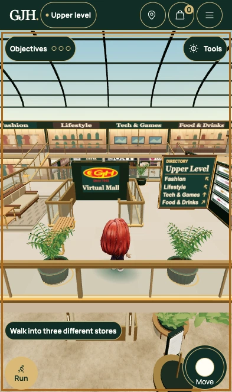
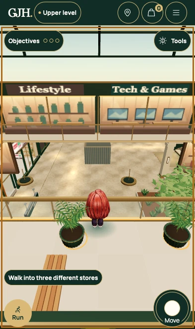

# GJH v11 · Premium Open Atrium

The expanded mall’s upper landing at +7.2 m now overlooks a permanent 5.47 × 12 m lightwell. The lift can be upstairs while visitors look down into the ground court. The arrival view pairs a GJH mark with a directory, an upholstered lounge and four illuminated category windows. The opposite gallery is display architecture. The 17 operating shop destinations remain on the ground floor.

## What the iPhone capture showed

Research used the supplied current and concept images and worktree revision `0181ffd6`.

| Existing owner | Finding and design decision |
| --- | --- |
| `atrium-layout.js`, `seat-placements.js` | The original atrium layout described ground-floor planting and lounges. The upper deck had three seats and four planters. Its seat anchors, published exits and bench IDs also drive the player’s sit/stand interaction. The shared layout now identifies the two slatted seats and the upholstered sofa. |
| `public-architecture.js`, `world.js` | The north and west edges already had display bays. The east roof cut lacked a finished frontage. A Chrome raycast through the pale steps in the arrival view also hit the tops of ground-floor window studios. A continuous east fascia, balcony edge and glazed outer return bays now screen those surfaces. A louvred cap and cladding finish the service reservation seen below the east rail. All four fascia centres share world Y = 11.40 m. |
| `public-architecture.js`, `mall-atmosphere.js` | The glazed barrel used overlapping transparent boxes against a flat scene colour. Single glass sheets sit along the original ribs above a world-space gradient. LEDs use emissive geometry. Warm floor washes join the existing atmosphere batch, with opacity selected by tier. |
| `lift-layout.js`, `elevator-v2.js`, `player.js` | The 12 m square landing already had four outer guards, a 4 m square shaft, a moving floor and a west gate. Its dark green centre panel is the back of the cabin. Exterior decorative GLB bays duplicated three of the four outer guards. The glass and Rapier perimeter supplied by the lift are reused with instanced gold posts, rail caps and light channels. |
| `brand-wall.js`, `script.js` | The former 17-plaque mesh built UV coordinates but never attached them. Its first upstairs visit also triggered an import, image decoding and GPU setup. The south story wall now has correctly wound atlas faces, all 17 story interactions and a 256 px atlas installed before walking. The central mark uses the existing GJH loader artwork on the cabin rear and on the fixed screen behind it. |
| `graphics-quality.js`, `scene-warmup.js`, `model-warmup.js` | Phone Auto resolves to Low. The loader’s scene sweep traverses hidden deck meshes. The upper level also queues its exact meshes and textures with landing lighting at startup and graphics recovery. The physical cabin carries its decal through both stops. `__mall.performanceReport().warm.upperLevel` reports the preparation state. |

## Design and asset sources

The west landing looks across lightly tinted glass and champagne rails toward the opposite arcade. A rug, floor lamp and side table group the existing upholstered seat into a lounge. The directory faces arrivals and its arrows follow the four windows in world order. The directory, mall mark, shop graphics, rug and daylight gradient share one 256 × 256 atlas using the signage kit’s colours and half-texel UV inset.

The sofa and four areca planters reuse the mall’s Blender pilot assets. Three texture-free glTF 2.0 files are byte copies from the Blender-3D-Gallery handoff at `output/v11-handoff/interiors/static/`. The scene merges their original coloured geometry into one opaque batch. A second slatted seat uses simple boards at its existing interaction anchor.

| Gallery asset | Source triangles | SHA-256 |
| --- | ---: | --- |
| GJH_NEW_bench_oak | 1,198 | `064fb57f222a95e9327e2fa9ea9e111a2020dbcfc02590c6d6060a54e7570bd9` |
| GJH_NEW_lamp_floor | 1,498 | `5cb040bd1982017acc97b2d96cb80963516be67814c92cab49d816539c1581f2` |
| GJH_NEW_table_display | 997 | `30234aa8ff7d21761920ee1527f374076ded2ae2d296f6499edea2e2759d4ba9` |

The stock loader checks dimensions and hashes. Local Khronos validation returned zero errors and zero warnings for all three delivered files. Each furnishing has an in-loader geometry fallback.

## Collision and navigation

- The original landing spans X −9…3 and Z 4…16. The visitor capsule has radius 0.30 m, half-height 0.55 m and a 0.20 m autostep. Full-height, continuous cuboids stop the capsule between posts and at corners. Existing sofa and bench colliders remain selectable for sitting.
- The permanent lightwell spans X 3…8.47 and Z 4…16. Its west boundary is the original east landing rail. The two glazed side galleries rise 1.46 m to meet the opposite storefront balcony. The slope, rail and physical guards use the same transform. There is no walking surface over the opening. The outer bridge edges, end caps and far frontage are also guarded.
- The lift shaft is a separate opening at X −5…−1 and Z 8…12. The cabin gate owns the only boarding passage, on the west at Z 9…11. Two short side returns protect the 0.40 m threshold. The docked threshold and cabin floor provide continuous support. The gate closes during travel and while the car is away.
- The floor finish clips to the real slab panels. Rugs, printed faces and LED strips have no walkable collision. The fixed directory, lamp base, side table and screen have small physical proxies. A 1.02 m aisle between the directory and south shaft guard connects both sides of the deck. The seat exits and west lift approach remain clear.

## Phone budget

These are conservative submissions for all new batches with frustum culling ignored. Counts include instance multiplicity and the moving logo. The comparison gives no credit for deleting the old decorative GLB bays, the old roof boxes or replacing two upholstered seat instances. The existing plaque wall remains one draw. On the higher tiers, the table charges the entire shared wash draw even though that batch was already present in the mall.

| Tier | Draws | Triangles | New lights / shadow casters | Largest upper texture |
| --- | ---: | ---: | ---: | ---: |
| Low · limit 6 / 6,000 | 6 | 5,937 | 0 / 0 | 256 × 256 |
| Balanced | 7 | 5,967 | 0 / 0 | 256 × 256 |
| Detailed | 7 | 5,967 | 0 / 0 | 256 × 256 |

The six Low submissions are the opaque furniture and architecture, printed faces, instanced brass, emissive channels, glazing and cabin mark. Balanced and Detailed expose the existing additive floor washes with their shared 64 px texture. The upper scene uses the direct pass on all tiers.

## Verification

`tests/gjh_upper_level.test.mjs` parses the shipped models, builds the production meshes and checks draws, triangles, lights, shadows, atlas dimensions and return to Low. Real Rapier capsule sweeps cover the outer landing, both lightwell side galleries, shaft corners, gate and docked threshold. Downward rays verify the permanent lightwell stays open with the cabin at either stop. A camera ray verifies that the visible centre panel samples the mark’s atlas cell at both stops.

Chrome DevTools ran the mall with the real loader, generated JavaScript, Rapier controller and GLBs in a 393 × 664 touch viewport at Low. The local review package supplied the worktree assets from memory because this environment denies HTTP socket binding. The capsule rode the lift to +7.2 m, reached the S01 story, sat and stood at the slatted bench and the lounge sofa, and stopped at the east rail with the cabin still upstairs. The visitor also crossed the directory aisle in both directions and rode back to the ground floor. The overview submitted 90 whole-scene draws. The upstairs bindings reported ready before the ride, and the instrumented asset loader recorded zero additional reads through arrival.

| West landing overview | East rail, cabin still docked upstairs |
| --- | --- |
|  |  |

The gallery generation check and 15 Python gallery tests passed. The Node suite passed 224 tests. One optional external SVG Studio checkout comparison was skipped. The repository’s HTTP browser gallery, GJH demo and PWA commands could not bind a loopback socket. Physical iPhone Safari frame pacing, driver memory and HTTP/PWA delivery remain unverified.
