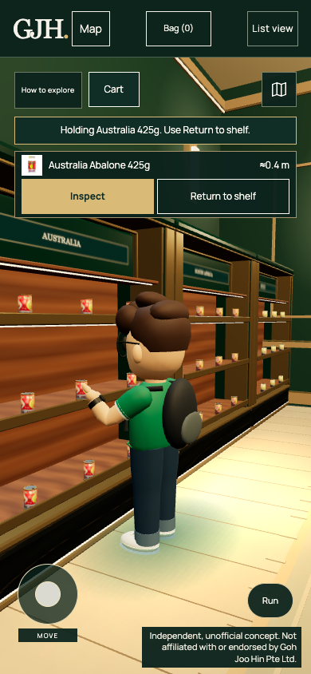
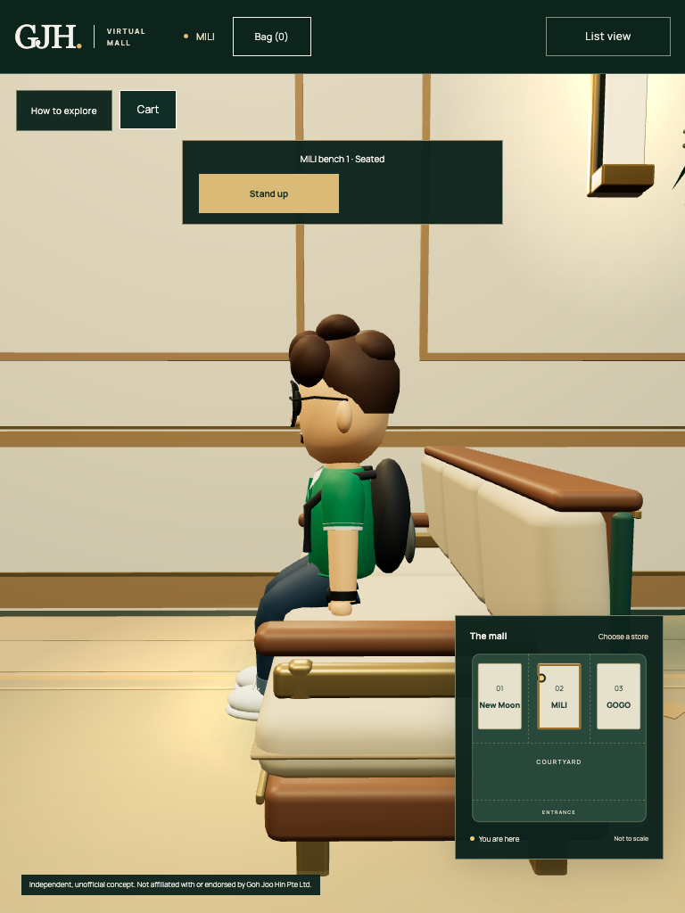
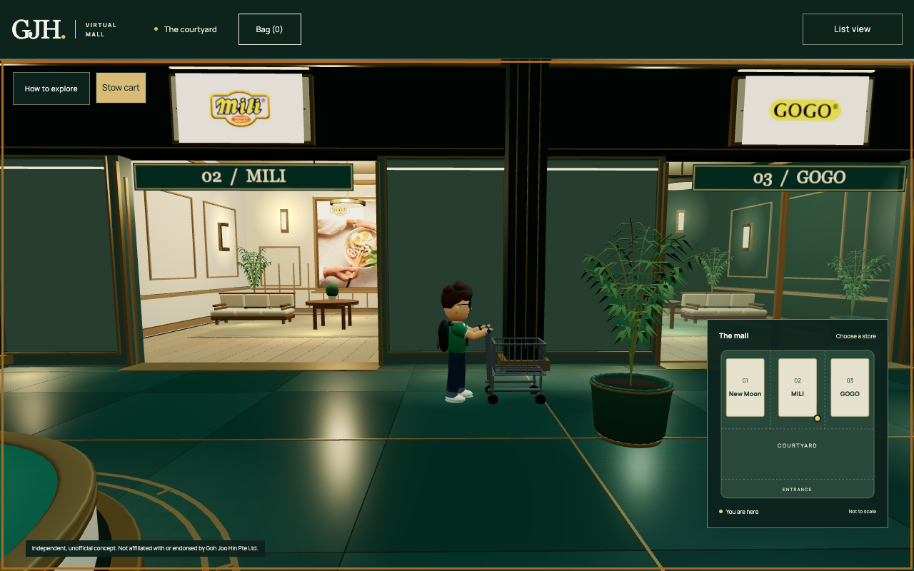

# Visitor v2 UX fixes and verification

Date: 2026-11-15 (Asia/Singapore).

For the subsequent authorized integration and deployment, see [release verification](gjh-visitor-v2-ux-release.md).

## Result and scope

Local candidate on `codex/visitor-v2-ux-fixes`, based on `53e98c25814ca454477a29b5506122e27e666fad`. The user's original working tree, staging area and unrelated edits were not overwritten. Changes and evidence are in this separate worktree. This request did not commit, push or deploy the candidate.

The seven findings in the preceding real-user/advisor audit are addressed. The independent advisor found no remaining P1/P2 in the reviewed camera, pickup, seating, cart and HUD scope. This is a scoped local acceptance, not device-performance or publication certification.

## Changes

- **Camera:** when an obstructed spring arm would show the avatar interior, hide only the avatar and restore it with hysteresis; keep the cart and world visible. Seated targeting blends to the lower body focus, so the feet fit the view. Normal third-person framing returns when clearance permits.
- **Bench access:** shop benches face the entrance, with a matching front anchor and usable approach range. The side view faces the room centre. The same orientation improvement applies intentionally to explicit v1. Sit and Stand share a stable HUD location. Decorative introduction text is suppressed while sitting, pushing or holding a product.
- **Pickup feedback:** retain the broad Inspect range, but gate physical pickup by the shelf-owned reachable approach metadata. Validate the capsule path, play a short approach and reach/lift, keep the can upright at the actual hand, then preserve an aisle-side close-up until movement or dismissal. Reduced motion uses a validated immediate approach/pose. Return aligns safely before transferring back. Stock reservation and exact instance restoration remain intact.
- **Held state:** a persistent badge identifies the product and its New Moon return shelf, including when away or at another SKU. A shared flow layout reserves separate space for identity and action controls. Redundant held-state copy is removed so landscape controls clear the touch stick.
- **Recovery:** held products produce a return-first message for Cart and seating. The Cart status cache observes held-item and elevator changes, clearing an obsolete rejection after its cause ends.
- **Cart entry:** a direct Cart/Stow cart button stays visible in the scene, with a pressed state. Blocking compact panels hide it. Clearance failure describes about three metres of open floor and a useful retry location. Bag remains an alternative entry.
- **Shelf keyboard recovery:** when Add reaches the nine-item demo limit, move focus from the newly disabled button to the enabled Details action inside the same dialog. During physical approach, Inspect remains hidden until the action ends.
- **Help:** v2 explains the actual contact-adjusted presentation, real control locations and physical-item separation. The explicit v1 route retains its own procedural-pose description.

## Verification

The real-input runner is `tests/browser_gjh_visitor_v2_real_input.py`. It uses browser key presses, taps, CDP touch events and native touch scrolling. `__mall.state` and an RAF trace are read-only oracles; this runner never calls teleport, setInput or step simulation hooks. It observes actual pickup/approach and align/sit intermediate states in normal motion. Reduced motion is a separate supplemental case.

| Gate | Evidence |
| --- | --- |
| Complete real-input suite | 22 checks pass; no page errors or console messages. See [JSON](evidence/visitor-v2-ux/real-input-all.json) and [log](evidence/visitor-v2-ux/real-input-all.txt). |
| Latest affected desktop flows | Four checks pass, including post-return Cart error recovery. See [JSON](evidence/visitor-v2-ux/real-input-desktop.json). |
| Explicit v1 regression | Three checks pass: original character, normal sit/stand and cart movement/stow. No page errors or console messages. See [JSON](evidence/visitor-v2-ux/real-input-v1.json). |
| Source/build contracts | 49 Python unit tests, generated-gallery check and SSOT check pass. |
| Existing web regression | Gallery browser checks, PWA browser checks and 28 GJH demo layout/navigation cases pass, including four no-JavaScript paths. Their raw logs are in the evidence directory. |
| Numeric/module layer | Existing normal/reduced-motion contact, exclusive reservation, exact stock restoration, cancellation and LOD module assertions pass. See [log](evidence/visitor-v2-ux/numeric-module.txt). |
| Shelf focused smoke | 320/390 viewports pass with no failures, including physical HUD/return phases, modal restoration, resource balance and keyboard recovery. See [result](evidence/visitor-v2-ux/shelf-smoke/results.json). |
| Shelf variants | Both M056 and DSP-001, 390/1440 widths, all four SKUs and two pickup/return rounds per combination pass. See [JSON](evidence/visitor-v2-ux/pilot-compatibility.json). This is an explicitly simulation-assisted compatibility layer, separate from real-input E2E. |

Real-input coverage includes 1280x800 keyboard; all eight benches; 768x1024 seated framing; 390x844 touch; 844x390 held-item orientation/layout; 320x568 and 768x1024 tool layout. It includes wrong-SKU return refusal, persistent identity after walking away, holding-item Cart/seat refusal, safe near-wall framing/restoration, direct cart stow and Help swipe/close.

Executed commands included:

```sh
python tests/browser_gjh_visitor_v2_real_input.py
GJH_REAL_SUITE=desktop python tests/browser_gjh_visitor_v2_real_input.py
GJH_REAL_SUITE=v1 python tests/browser_gjh_visitor_v2_real_input.py
GJH_MODULE_ONLY=1 GJH_V2_URL=http://127.0.0.1:18773/demos/corporate/gjh/v11/ python tests/browser_gjh_visitor_v2.py
python tests/browser_gjh_interior_pilot_compatibility.py
python tests/browser_gjh_shelf_focus.py --smoke --output docs/evidence/visitor-v2-ux/shelf-smoke
python -m unittest discover -s tests -p 'test_*.py' -v
python scripts/build_gallery.py --check
python scripts/check_ssot.py
python tests/browser_gallery.py
python tests/browser_pwa.py
python tests/browser_gjh_demos.py
```

Execution used the existing Playwright Python environment and installed Chrome on this macOS host. The new real-input runner uses Chrome's default GPU path; the original numeric runner retains its existing software-rendering configuration. No phone FPS conclusion follows from either.

## Evidence reviewed







The advisor independently reviewed source, result JSON and the actual final held/camera/cart/seated/landscape frames. A final review of the Cart cache correction also passed. The primary agent completed the supplemental numeric and v1 gates. Candidate file hashes are recorded in [source-hashes.json](evidence/visitor-v2-ux/source-hashes.json).

## Harness corrections and evidence boundaries

Early runs caught and corrected actual implementation defects in camera angle, HUD ownership, decorative text and landscape copy. Harness corrections also distinguished wide-map access, native modal-focus completion, legal routes around furniture/doors, joystick dead-zone behaviour, and asynchronous disclosure completion. No gameplay assertion was removed to obtain a pass. The stopped-ground reference in the deterministic held-key fixture is settled before testing; its original strict height bound remains. The nine-item focus assertion now checks the actual enabled recovery action rather than relying on browser-specific focus retention on a disabled button.

The old compatibility fixture assumed Inspect and pickup shared one range; it now explicitly approaches physical range after checking exact Shelf framing/restoration. The close-event snapshot retains the exact restoration precision; resumed grounding is checked separately against the existing shared Shelf test's Float32 bound. Deterministic fixtures and numeric tests do not replace the real-input suite.

Physical iPhone/Android, Safari hardware, screen-reader journeys, thermal/memory/FPS performance, crowd behaviour and photoreal finger grasping remain outside this verification. LOD code is unchanged: the isolated module switches, but the current hero camera normally remains inside the high-detail range and no NPC crowd is shipped. Full-mall mobile LOD benefit is not claimed.

The local preview is served at `http://127.0.0.1:18773/demos/corporate/gjh/v11/`. Generated gallery metadata was rebuilt only in this worktree. Unrelated test-generated legacy/gallery screenshots were restored to their baseline; the focused v2 evidence is retained.
