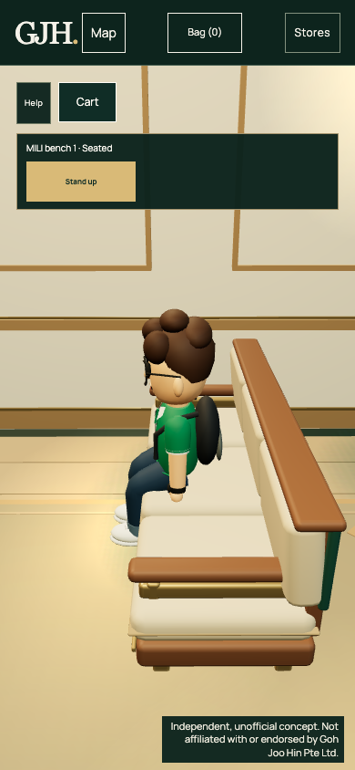
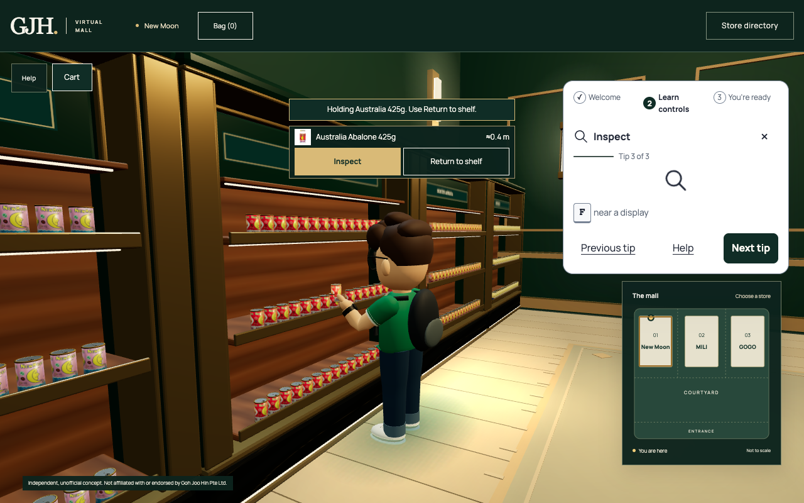
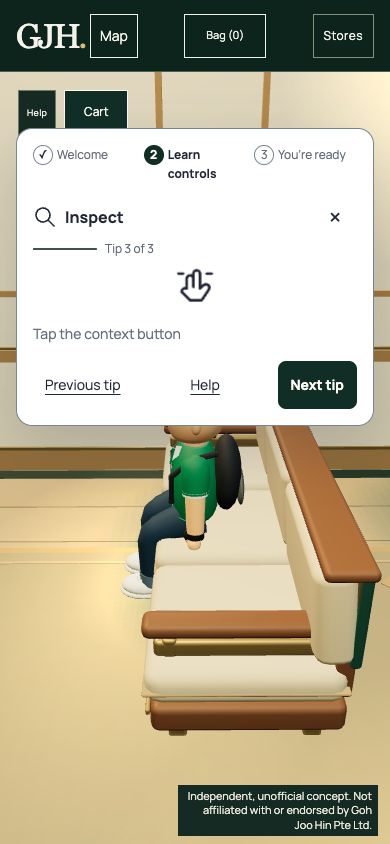

# Visitor v2 UX release verification

## Final visual correction

The initial public input assertions passed, but screenshot review caught an additional real integration defect: the incoming mobile onboarding tip covered the seated character and Stand action. Public visual acceptance was reopened rather than treating input actionability as visible usability.

The onboarding owner now separates `setHUDSuppressed` (presentation only) from `setSuspended` (modal/input eligibility). V11 yields contextual tips while the action HUD, held product or cart owns the scene, retaining tutorial progress. Confirmed Inspect still advances; closing the viewer and walking away restores the completed “Keep exploring” tip. No forced focus migration is added. The advisor re-reviewed this split with no remaining P1/P2 in scope.

Local current-source preflight: keyboard five checks and touch seven checks PASS, including real Inspect completion and unobscured held/cart/seated HUD assertions. Normal animations remain enabled. Unit49, generated freshness, SSOT and whitespace checks PASS. See [keyboard](evidence/visitor-v2-ux-release/final-local-desktop.json), [touch](evidence/visitor-v2-ux-release/final-local-touch.json) and [final source hashes](evidence/visitor-v2-ux-release/final-source-hashes.json). The first completion-label fixture used “Done”; it was corrected to the actual existing “Keep exploring” label, retaining exact state and visible-after-walking assertions.

Final functional release: [`a7f4ef3c71e8f023ce851917fb0498d1599d9d63`](https://github.com/yapweijun1996/Webpage-Design-Gallery/commit/a7f4ef3c71e8f023ce851917fb0498d1599d9d63). [Pages run 43688638355](https://github.com/yapweijun1996/Webpage-Design-Gallery/actions/runs/43688638355) completed successfully. All seventeen checked public resources match the final source bytes at exact HTTP200 URLs: [final public hashes](evidence/visitor-v2-ux-release/final-public-runtime.json).

The fresh **15-check final live release suite PASS** exited0 with zero page errors and zero console warnings/errors. It covers normal-motion keyboard and touch pickup/return, wrong-shelf/held restrictions, compressed camera/restoration, actual cart movement/stow, natural seat entry/sit/stand, tutorial presentation/progress, Help touch scroll and small/tablet tools. The hidden-tutorial assertions pass for held/cart/seated states; real Inspect reaches “Keep exploring” and that completed tip is visible after leaving the interaction point. See [final live results](evidence/visitor-v2-ux-release/final-live-real-input.json) and [log](evidence/visitor-v2-ux-release/final-live-real-input.txt).

Final screenshots were inspected: the character, feet and Stand action remain visible without the tutorial overlay. The existing in-app browser tab was refreshed after publication and the loaded final scene observed. All validation uses actual browser key/touch events and normal animation, with read-only runtime oracles; no simulation movement or time-step hooks are called. This validates browser touch handling, not physical phone hardware performance.




## Scope and integration

The reviewed visitor camera, physical pickup/return, cart, seating and HUD fixes are integrated with upstream `e67c2d9b3400a4219766dd5fbeaf16f404320efe`. Preserve the incoming sphere-sweep camera, furniture bounds, amenities, native-size dense shelf stock, Help/Map ownership, onboarding and automatic product preview with wheel/pinch zoom. Avatar-only close-camera visibility retains the cart and world.

All work uses the isolated `codex/visitor-v2-ux-fixes` worktree. No checkout, reset, stash or staging operation was applied to either original dirty worktree. Both original staging areas matched their initial fingerprints; concurrent external edits remain owned by their originating work.

## Pre-deployment gates

- 49 Python unit tests; generator freshness; SSOT; diff whitespace: PASS.
- Gallery and PWA browser regressions: PASS. 28 legacy-demo browser cases and four no-JavaScript journeys: PASS.
- Help/Map/onboarding: ten cases PASS. Existing sphere-camera furniture and continuous walking regression: three variants PASS.
- Normal-motion real keyboard and touch: 23 accumulated checks PASS, including all eight benches, tablet seating, original-shelf return, held-item refusal, camera compression/restoration, cart movement/stow and compact layout. See [machine-readable local results](evidence/visitor-v2-ux-release/local-real-input.json).
- Two obsolete cross-store fixture routes encountered actual furniture. The final route follows the clear front aisle; no collision was removed and no gameplay assertion was weakened. Targeted reruns passed with the unchanged integrated runtime.
- Advisor pinned its final source review to candidate `a162eeb` versus upstream `e67c2d9`; no additional P1/P2 integration issue found.

[Source hashes](evidence/visitor-v2-ux-release/source-hashes.json) pin the thirteen changed runtime files. Historical earlier-candidate evidence remains in [the original fix report](gjh-visitor-v2-ux-fixes.md).

## Initial deployment and input-layer acceptance

Published code commit: [`eced12c91afb270955c50b460f73c1080876355e`](https://github.com/yapweijun1996/Webpage-Design-Gallery/commit/eced12c91afb270955c50b460f73c1080876355e).

[GitHub Pages run 43687815886](https://github.com/yapweijun1996/Webpage-Design-Gallery/actions/runs/43687815886) completed successfully, including SSOT, unit tests, freshness and deployment. The public URL is [GJH Virtual Mall](https://yapweijun1996.github.io/Webpage-Design-Gallery/demos/corporate/gjh/v11/).

Seventeen public resources (the thirteen changed runtime files, preserved preview/amenity/onboarding modules and version metadata) returned HTTP 200 at the exact requested URLs and matched the committed bytes. See [public byte verification](evidence/visitor-v2-ux-release/public-runtime.json).

The fresh public release suite exited successfully: **13/13 checks PASS, zero page errors and zero console warnings/errors**. Both keyboard and touch exercised normal-motion physical pickup, wrong-shelf/held refusal and original-shelf return; near-wall safe view and restoration; direct cart entry, actual movement and stow; natural bench entry, sit and stand. Touch also exercised Help scrolling and landscape held presentation; 320/768 tool layouts passed. See [live results](evidence/visitor-v2-ux-release/live-real-input.json) and [log](evidence/visitor-v2-ux-release/live-real-input.txt).

The existing in-app browser tab was switched from the local candidate to the public site, the quick guide was started and the loaded scene/Cart controls were observed. The tab is retained for user testing. The following exact command produced the public acceptance:

```sh
GJH_V2_URL=https://yapweijun1996.github.io/Webpage-Design-Gallery/demos/corporate/gjh/v11/ GJH_REAL_SUITE=release GJH_REAL_OUTPUT=/tmp/gjh-v2-release-live python tests/browser_gjh_visitor_v2_real_input.py
```

The release suite covers all four requested flows with native browser keyboard and CDP touch input, normal animation, read-only state/RAF observations and 320/768 layout checks. It never invokes teleport, setInput or step hooks; map buttons remain normal user actions.

Physical iPhone/Android/Safari, thermal/FPS measurements and full-mall LOD performance benefit are not certified by browser touch emulation.


## Initial browser evidence (superseded by visual correction)




