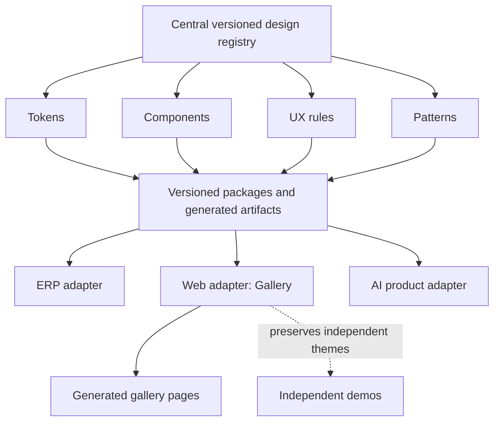

# Gallery Design System — SSOT

**Specification version: 1.0.0** · **Application release: 1.1.2** · **Status: implemented local contract with verified scope and stated limits** · **Audit baseline: `e42153f`** · **Date: 2026-11-12**

This document is the single source of truth for shared gallery design decisions, component contracts, UX rules and acceptance criteria. Version 1.0.0 establishes the contract and tracks its incremental implementation. It does **not** certify complete application compliance. The issue register records the reviewed baseline; the adoption record distinguishes delivered source changes from verified behavior and remaining work.

## 1. Product scope and principles

The gallery helps people choose a company, explore its design directions, inspect a design and open its live demo. Comparison supports that journey. Discovery content and meaningful next actions take priority over explanatory copy and maintenance diagnostics.

The shared system governs the gallery shell, directory, company collection, detail, comparison and PWA utility surfaces, plus explicitly scoped GJH interaction primitives and theme registries. Independently authored demos retain their own visual identities, typography, colors, motion and layout. Gallery rules must not silently restyle content inside demo iframes. Existing demo URLs and company-first navigation remain stable.

Define a rule once, implement it in one owned source, and reuse it across applicable surfaces. Reuse means shared semantics and behavior, not merely copying matching colors. Preserve semantic HTML, keyboard operation, browser zoom, progressive enhancement and explicit update consent.

## 2. Evidence and interpretation

Evidence labels used throughout this document:

- **OBSERVED:** visible in the user-supplied 1919 × 982 screenshot, including browser chrome. Positions are approximate image coordinates, not measured DOM bounds.
- **SOURCE_CONFIRMED:** directly established by the source at the reviewed commit.
- **RECOMMENDATION:** an adopted target design decision awaiting implementation and validation.
- **TEST_CANDIDATE:** a reproducible acceptance check proposed for future implementation; not a test result.

The screenshot shows the header, introduction, directory filters and the beginning of a company card. It cannot establish mobile behavior, keyboard behavior, live deployment freshness, contrast conformance or physical-device behavior. Its displayed build identifier is not the Git commit identifier; do not equate them.

Source inspection confirms one company and eight designs. Existing [gallery evidence](docs/gallery-v2-review.md) includes a historical synthetic capacity fixture of 120 companies and 1,200 designs. That is not a published inventory, a current performance measurement or proof of production scalability. Its older real-inventory counts are historical, not catalog authority.

### Reconciliation of suggested issues

| Suggestion or assumption | Current evidence | Correct action |
|---|---|---|
| Add a three-column company grid | `.company-grid` already uses three columns, two at 1000px and one at 650px in [gallery CSS](assets/gallery.css). | Improve single-company composition and responsive content fit; do not report a missing grid. |
| Add search, category and sorting | Directory controls already exist in [the generator](scripts/build_gallery.py), and [gallery JavaScript](src/gallery.js) implements them. Company collections also have style and order controls. | Improve relevance, state persistence, hierarchy and small-inventory behavior. |
| Design for 100+ companies | Existing pagination displays 12 results per page; all static cards remain in the DOM. Historical synthetic functional coverage exists. | Treat 100+ as a capacity target requiring current measurements, not a reason to invent inventory or claim proven speed. |
| Standardize on Lucide | Current [icon provenance](assets/icons-sources.json) names SVG-Icon-Studio sources; templates and generator embed inline SVG. | Preserve provenance and define one owned icon source. A library migration requires a separate justified change. |
| Enforce with `check-ssot` | No gate existed at the reviewed baseline. | `scripts/check_ssot.py` now implements generated-artifact, semantic-token, icon and debt-ratchet checks; see adoption evidence below. |

## 3. Prioritized issue register

Priority describes remediation order, not measured conversion impact. There is no evidence of a P0 production outage in this audit.

| ID / priority | Evidence and issue | Target resolution | Acceptance |
|---|---|---|---|
| UI-01 / P1 | **SOURCE_CONFIRMED:** [base template](templates/gallery/base.html) sets `maximum-scale=1, user-scalable=no`; [gallery JS](src/gallery.js) suppresses `gesturestart`. [PWA tests](tests/browser_pwa.py) assert the restrictive viewport string. | Allow browser zoom; remove gallery gesture suppression and replace the old test expectation together. Preserve `viewport-fit=cover`. | A01 |
| UI-02 / P1 | **OBSERVED:** header ends near y=138, hero near y=565, first card starts near y=836; its title/action are below the supplied image. **SOURCE_CONFIRMED:** intro, heading and filter spacing accumulate before the card. | Compress the introductory stack and reveal an identifiable company choice earlier. | A02 |
| UI-03 / P1 | **SOURCE_CONFIRMED:** [gallery CSS](assets/gallery.css) and later-loaded [PWA CSS](assets/pwa.css) both own header spacing, container gutters and form sizing. PWA CSS adds another release row at 1100px. | Consolidate shared foundations and layout ownership; PWA styles consume them. | A03 |
| UI-04 / P2 | **OBSERVED:** inventory repeats in badge, section summary and result status. A wide search/category/sort row precedes one company. | Use explicit inventory-size states and reduce redundant visible counts; retain an accessible live result announcement. | A04 |
| UI-05 / P2 | **SOURCE_CONFIRMED:** header max-width is 1360px; normal content is 1280px, both with 40px padding. **OBSERVED:** their left content rails differ by about 40px. | Align normal header/main/footer rails; keep a documented wide comparison workspace. | A02, A03 |
| UI-06 / P2 | **OBSERVED:** persistent version/build diagnostics and update button occupy primary header space. **SOURCE_CONFIRMED:** narrow layouts allocate a full release row. | Keep release details secondary; promote actionable updates without changing consent semantics. | A05 |
| UI-07 / P2 | **SOURCE_CONFIRMED:** “Categories” links to a directory filter anchor; “Companies” remains current on both directory routes. Secondary links are hidden at 650px. | Name destinations accurately; categories remain a directory control. Keep secondary destinations reachable on mobile. | A06 |
| UI-08 / P2 | **SOURCE_CONFIRMED:** [company template](templates/gallery/company.html) places the comparison tray after the entire grid. Selection survives filtering but only a global Clear action is provided. | Present a contextual selection summary with per-item removal and a nearby compare action. | A07 |
| UI-09 / P2 | **SOURCE_CONFIRMED:** directory reads initial `q` and `category`, but does not write updated filter/sort/page state to the URL. | Define reload, share and Back behavior through a normalized URL state contract. | A08 |
| UI-10 / P3 | **SOURCE_CONFIRMED:** six base color tokens coexist with many literal sizes/colors/radii; mobile CSS broadly changes almost every anchor's layout. | Introduce semantic tokens and explicit component target sizing. | A03, A09 |
| UI-11 / P3 | **OBSERVED / SOURCE_CONFIRMED:** explanatory browse steps use an outbound-arrow icon without being links. | Use neutral instructional treatment or actual meaningful destinations. | A06 |
| UI-12 / P3 | **OBSERVED / SOURCE_CONFIRMED:** secondary text includes 10–12px labels. No contrast measurement was performed. | Improve essential-label readability and measure contrast/text enlargement. Do not label a contrast failure from appearance alone. | A01, A09 |

## 4. SSOT architecture and ownership

The following diagram is the **target architecture**. In this repository, `ds.md` is the local versioned contract; `design-system/` is the executable local registry, and CSS/templates/JavaScript are its consumers. There is no deployed central registry, published shared DS package or demonstrated ERP/AI adopter.

“Central” means one canonical definition per rule, not an immediate requirement for a registry service or framework migration. The first implementation should remain compatible with this project's dependency-free Python/static architecture.

| Layer | Authoritative authoring source | Ownership boundary |
|---|---|---|
| Design intent and acceptance | This `ds.md` | Product/design contract; no duplicated live inventory |
| Canonical token values and aliases | [design-system/tokens.json](design-system/tokens.json) | Sole editable token source; Python generates `assets/tokens.css` |
| Shared gallery components and layout | [assets/gallery.css](assets/gallery.css) | Consume generated tokens; own controls and rails |
| PWA utility presentation | [assets/pwa.css](assets/pwa.css) | Update, install, offline, dialog and explicit shell integration; consume shared tokens |
| Page semantics | [templates/gallery/](templates/gallery/) | Landmarks, headings, static page composition |
| Card and filter generation | [scripts/build_gallery.py](scripts/build_gallery.py) | Existing generated component markup; future extraction must preserve one template owner |
| Discovery/detail/compare state | [src/gallery.js](src/gallery.js) | One controller per behavior; DOM is a projection of state |
| PWA state | [src/pwa.js](src/pwa.js), [worker template](templates/gallery/sw.js) | Update/install/cache behavior; do not duplicate in gallery controller |
| Catalog facts | [companies](data/companies.json), [categories](data/categories.json), [styles](data/styles.json), demo `metadata.json` files | Content IDs, titles, classification and order; not DS-owned |
| Canonical shared icons | [design-system/icons.json](design-system/icons.json) | Approved SVG-Icon-Studio definitions generate `assets/icons.svg`; [existing receipts](assets/icons-sources.json) preserve provenance |
| Generated outputs | Gallery HTML, `data/designs.json`, `version.json`, `sw.js` | Rebuild from sources; never repair drift by hand-editing outputs |
| Independent demo themes | [design-system/themes.json](design-system/themes.json) → [assets/gjh-themes.css](assets/gjh-themes.css) | Canonical per-version colors, typography, radii, shadows and layers; scoped by `data-gjh-design` |
| Independent demo compositions | Each `demos/...` directory | Own geometry, layout, scene artwork and concept-specific runtime; shared interaction modules are explicitly scoped |
| Historical verification | `docs/` review/evidence files | Evidence at its recorded revision; not a competing current specification |

Precedence: user/repository constraints govern scope and permissions; this document governs intended design; authoring sources establish actual implementation; generated outputs reflect sources. When intended and actual behavior differ, record a gap rather than describing the target as already shipped. Historical review prose never overrides current catalog or source evidence.

## 5. Foundation contract

Canonical values now live in [tokens.json](design-system/tokens.json), compiled to [tokens.css](assets/tokens.css). The table summarizes their roles; JSON wins if this explanatory summary becomes stale. Consumers use semantic names and the retained migration aliases.

| Token family | Proposed values / semantics |
|---|---|
| Foreground | `--color-text: #202635`; `--color-text-muted: #626c7a`; `--color-text-on-action: #ffffff` |
| Surface | `--color-page: #f7f8fa`; `--color-surface: #ffffff`; `--color-surface-subtle: #edf0ff` |
| Action | `--color-action: #4554d8`; `--color-action-hover: #303fbd`; focus uses action color with a separate visible outline |
| Border | `--color-border-subtle: #e0e4eb`; `--color-border-control: #788495`; validate essential boundaries rather than assuming a decorative border is sufficient |
| Feedback | Semantic success/warning/error tokens; pair color with text/icon and define final values only after contrast checks |
| Spacing | `--space-1` through `--space-12` use 4px steps; `--space-16` is 64px and `--space-20` is 80px; name deliberate exceptions |
| Type | System sans-serif stack; body 16px/1.6; essential labels 14px; metadata 12–14px; responsive display 36–56px/1.12; section title 24–28px/1.3 |
| Radius | Small 4px; medium 8px; card 12px; dialog 16px; pill only for actual badge/chip shapes |
| Rails | Normal outer width 1280px including gutters; wide comparison outer width 1760px; gutters 22px narrow, 40px wide, combined with safe-area insets |
| Targets | Interactive target aim 44 × 44px; avoid changing unrelated inline prose links into blocks |
| Motion | Short feedback transitions around 150–200ms; no essential meaning conveyed only through animation; reduced-motion alternative |
| Layers | Named order: content, contextual controls, app chrome, dialog/backdrop, skip link; avoid arbitrary component z-index escalation |

Tokens must describe roles. A demo's forest green is not a gallery action token. Avoid literal component overrides when the intended change belongs to a shared token. A documented one-off illustration color is not automatically a token violation.

### Token authoring migration

The former six variables in `assets/gallery.css` are now compatibility aliases emitted from **`design-system/tokens.json`**. That file contains primitive values, semantic references and aliases; **`scripts/build_design_system.py`** compiles them to **`assets/tokens.css`**. JSON is the only raw-value authoring source. Generated CSS must not become a second editable registry. `assets/gallery.css` owns component rules consuming these variables. Generation uses Python, without npm.

Migration aliases: `--ink` → `--color-text`, `--muted` → `--color-text-muted`, `--accent` → `--color-action`, `--line` → `--color-border-subtle`, `--surface` → `--color-surface`, `--page` → `--color-page`. Preserve explicit differences between decorative separators and essential control boundaries. The measured raw-style categories now have zero remaining declarations against the original 1,211-entry baseline. The check measures literal colors plus `border-radius`, `box-shadow`, `text-shadow`, `font-size`, `font` and `z-index`, together with shared ownership rules. It does not prohibit every CSS number: intentional geometry, layout dimensions, media-query syntax and independent scene construction remain in component styles.

If themes are later needed, keep theme, palette, component kit and density as independent configuration axes. A dense ERP adapter must not silently change semantic status colors; an independent demo theme does not inherit gallery density. Only introduce supported combinations with actual consumer evidence.

## 6. Layout and responsive contracts

- Normal header, main content and footer share the same content rail. Comparison may use the wider rail intentionally.
- Narrow (up to 650px): one-column cards, compact introduction, stacked controls as required, reachable secondary navigation and safe-area gutters.
- Medium (651–1000px): up to two company columns; two design columns only while titles and actions fit. Comparison stacks at 800px as its current starting rule.
- Wide (above 1000px): up to three company columns and two design columns. Do not stretch a lone company card across all columns merely to fill space.
- Header breakpoints are content-fit decisions. Existing 1100px wrapping is an implementation fact to reassess, not an additional universal DS breakpoint.
- Use flexible layout and wrapping; viewport buckets alone do not prove that long company names or translated content fit.
- At small inventory sizes, reduce introductory height and redundant controls before sacrificing card identity or readable text.
- At 1440 × 900, the one-company entry state should expose a company title and meaningful collection action without scrolling. This is a project-specific target, not an externally certified usability threshold.
- Do not force the complete company card above the fold on short mobile screens. Preserve readable content and an obvious continuation.

## 7. Component contracts

| Component | Required semantics and states | Rules |
|---|---|---|
| App header | Home identity, navigation, secondary release utility; current destination, compact layout, update available | One visible primary journey; build hash belongs in secondary diagnostics; mobile destinations remain reachable |
| Intro | One page `h1`, short purpose, meaningful entry action | Avoid duplicate instructions and inert action icons; reduce height for a sparse catalog |
| Button/link | Default, hover, pressed, focus-visible, disabled, busy | Links navigate; buttons act. Disabled links require actual activation prevention, not opacity alone. Busy controls retain accessible names |
| Search/filter | Visible label, current value, clear/reset, no matches, disabled where meaningful | Search is not placeholder-only; filtering does not unexpectedly move keyboard focus |
| Company card | Accessible navigation name, identity, image/fallback, description, design count, collection action | Whole card may be a link; no nested interactive controls. Titles/actions remain identifiable before preview decoration |
| Design card | Detail link, live-demo link, comparison checkbox; selected/unselected/limit-reached | Multiple actions remain separate semantic elements; never wrap the whole card in a link |
| Result summary | Total and filtered/page count, polite live update | Avoid three visually competing versions of the same inventory fact |
| Selection tray | Zero/one/two selections; individual removal; clear; disabled/enabled compare | Appears contextually after selection; names selected designs even when filtered out; sticky form must reserve space and not obscure focus |
| Device control | Labelled button group, one `aria-pressed` value | Device changes update actual preview viewport/screenshot, not just button styling |
| Comparison panel | Named preview, open-demo link, live/screenshot mode, unsupported/fullscreen/error | Relative scroll synchronization is optional; explain scaling; provide recovery when embedding fails |
| Notice/dialog | Information/warning/error, busy/success/failure, dismiss/retry where applicable | Status text communicates outcome; dialog focus and return focus are verified; do not conflate offline with update failure |
| Empty/error state | Explanation and appropriate recovery | Distinguish empty catalog, no filter matches, invalid URL, network failure and unavailable offline media |

## 8. UX state and data contracts

### Discovery

Current source already provides search, category filtering, sorting, 12-item pagination and zero-match recovery. The target adds coherent state restoration and inventory-aware presentation.

| Inventory/state | Target behavior |
|---|---|
| No companies | Explain that no collections are available; no meaningless sort/pagination |
| One company | Prioritize its collection; hide ineffective sort and category choices with no useful alternatives; retain discovery controls when they offer a meaningful result |
| Several companies | Search/category/sort operate consistently; card width follows the normal grid |
| More than 12 matches | Page controls and range summary; change of query/filter returns to page 1 |
| No matches | Keep query visible, explain result and offer reset; focus returns to the relevant control on explicit reset |
| No JavaScript | Static company-to-demo navigation remains available; enhancement limits are disclosed |

Proposed URL state keys are `q`, `category`, `sort`, `page` for directory discovery and `style`, `sort` for collections. Validate values against the catalog/options; unknown values normalize to defaults; omit defaults from canonical links. Use replace-state for typing/filter adjustments to avoid one history entry per keystroke, and explicit navigation semantics for page changes. Reload/copy-link reproduces the visible result; Back restores a previously visited state. Add `popstate` handling when adopting this contract.

### Comparison

Selection belongs to one company and is a set of zero to two valid design IDs. Filtering never silently drops a selection. Each selected item can be removed from the tray. A third choice explains the limit rather than silently changing a prior choice. The comparison URL remains the authority for its two distinct same-company designs; invalid input produces a recovery view, not partially initialized frames. Session persistence of a draft selection is optional and must be explicitly documented if added; do not imply it exists now.

The current collection derives its company from the first card's detail URL. A future explicit page company identifier should be preferred so the state contract does not depend on card order or nonempty inventory.

### PWA and availability

Preserve current explicit activation consent, same-URL reload, failure recovery and project-scoped cache guarantees. Keep online/offline state independent of release state. A connected device may still run an older installed build. Browsing cached company collections does not imply that heavy demos or full screenshots are cached. Update checking, update ready, applying, applied and failed states require distinct messages and actionable recovery.

## 9. Cross-project reuse and compatibility

This repository is the only product adopter established by this work, including its gallery and eight scoped GJH themes. ERP and AI in the diagram are future consumers, not existing integrations.

The reusable core should describe token roles, accessible component semantics, interaction states and patterns without requiring React, Vue, an ERP framework or an AI SDK. Product adapters bind those contracts to local components and data models. ERP may require dense tables and validation patterns; an AI product may require streaming, cancellation and uncertain-output states. Those extensions must be named and versioned, not presented as existing gallery features.

When a registry/package is implemented, publish a versioned manifest containing contract version, token schema version, component/pattern identifiers, compatibility range, source revision and artifact digest. Pin consumers to a released version; do not consume an unversioned “latest” endpoint at runtime. Generated CSS/JSON/documentation should come from the same authoritative definitions. Do not add a second manually maintained token table in each consumer.

Adapters may map platform primitives and product themes while preserving required semantics and behavior. Exceptions need an owner, reason, scope, evidence and review date. Independent demo themes are an intentional permanent boundary, not accidental noncompliance.

## 10. Change governance

DS specification version and application version/build are different identifiers. `data/app.json` remains the application version authority. Changing this document does not automatically change the application version or certify DS compliance.

- **Major:** remove/rename a required token or component contract, change required behavior incompatibly, or alter a consumer's compatibility obligations.
- **Minor:** add backward-compatible tokens, components, patterns or optional capabilities.
- **Patch:** clarify wording or fix a specification error without changing the intended consumer contract.

For each implementation change: identify affected rule IDs; inspect current source and evidence; define migration and compatibility; edit the authoritative source; rebuild outputs when applicable; run relevant checks; review the actual flow; record adoption status and limitations. Do not mark a rule adopted until its acceptance evidence exists. Deprecations should retain documented aliases through a stated migration window; remove them only in the declared breaking release.

Proposed adoption phases: (1) zoom and ownership correction, (2) entry hierarchy and sparse-catalog behavior, (3) selection/navigation state improvements, (4) semantic tokens and enforcement, (5) shared packaging only when another real adopter needs it. These phases are planning guidance, not authorization for runtime changes or release.

### Implemented static gate and remaining limits

`python3 scripts/check_ssot.py` checks known contract invariants, not visual taste. Its implementation covers generated token/icon freshness, alias resolution, semantic contrast pairs, approved icon definitions, new raw-value debt and component ownership. The complete gate contract remains:

1. Parse the canonical token source; reject missing references, duplicate canonical definitions and incompatible declared versions.
2. Detect forbidden generated-file-only changes by comparing a fresh generator output.
3. Enforce explicit shared-style ownership and scoped exceptions; do not blanket-ban all CSS literals or demo themes.
4. Check prohibited zoom restrictions and required semantic component hooks.
5. Validate icon source references and required provenance without assuming a particular external icon library.
6. Report rule ID, source location and actionable fix. Keep visual/browser criteria in browser review rather than pretending static checks prove them.

The implemented ratchet preserves the original count from `e42153f` for history, but its active declaration allowance is empty. It rejects any reintroduced measured literal, including an exact old value. An exception must name its rule and owner. A broad allowlist that silently accepts all new literals is not a ratchet.

Use the static gate alongside gallery generator consistency, source review and browser verification. Static success does not establish responsive usability, complete accessibility or independently themed demo compliance.

## 11. Acceptance matrix

All entries below are **TEST_CANDIDATE**, except the limited baseline checks recorded in section 12. Use an HTTP-served build under the GitHub Pages path prefix. Record viewport, browser, source revision and screenshot/state for visual evidence.

| ID | Reproduction and expected result |
|---|---|
| A01 | Remove restrictive viewport/gesture logic and update old PWA assertions. Exercise browser zoom/text enlargement at 200%, 320px reflow, and physical touch pinch where available. No essential action or text is lost; no page-level horizontal overflow. Record untested devices explicitly. |
| A02 | Capture entry at 1440 × 900 and supplied-image-like desktop dimensions. A company title and collection action appear without scrolling at 1440 × 900. Header/main/footer rails align. Review mobile separately without forcing a desktop fold target. |
| A03 | Inspect source ownership: shared tokens/layout/controls have one owner; PWA consumes rather than independently redefines them. Rebuild is deterministic; independent demos remain untouched. |
| A04 | Use temporary fixtures for 0, 1, 2, 12, 13 and 120 companies. Check accurate counts, useful controls, empty recovery and page boundaries. Never publish fixture records. Measure load/filter behavior separately before making performance claims. |
| A05 | Exercise idle, checking, available, applying, failure and offline states. Update remains discoverable and explicitly activated; diagnostics do not dominate the entry header; same URL survives reload. |
| A06 | Traverse header/intro with keyboard and narrow viewport. Labels match destinations, secondary destinations remain reachable, informational steps do not masquerade as actions, and current-page state is accurate. |
| A07 | Select one then two designs, filter one out, remove it through the tray, attempt a third choice, clear, and compare. Visible names/counts/disabled states stay consistent; focus is never covered by a sticky tray. |
| A08 | Set search/category/sort/page, reload, copy URL, navigate away and Back. Normalized URL and visible results agree. Invalid values recover predictably and query changes reset pagination. |
| A09 | Inspect computed colors and component states; measure text/control contrast; test keyboard focus, long titles and 44px target intent. Do not infer full accessibility conformance from automated tooling alone. |
| A10 | Exercise details/comparison with missing/invalid parameters, live-preview failure, screenshots, device sizes, optional scroll sync and unsupported fullscreen. Recovery remains available and independent demo URLs stay stable. |
| A11 | Verify 375, 390, 768, 1024, 1440 and 1920px plus both sides of each affected breakpoint; no document-level horizontal overflow. Test safe-area behavior where a supporting device is available. |
| A12 | Disable JavaScript, then exercise cached browsing offline and unavailable demo/full-screenshot paths. Static browsing survives and availability messages accurately describe the limitation. |

For runtime adoption, run the applicable commands in [README](README.md#verification), including gallery/PWA checks and affected demo checks. The old restrictive-viewport assertions were replaced with zoom-permitting viewport and unsuppressed-gesture checks. Functional passes alone do not close visual issue IDs.

## 12. Verification and adoption record

Advisory skill provenance: `kb-mcp:ui-skills` 0.3.0 and `kb-mcp:coding-skills` 0.2.1 supplied routing context; the coordinating agent loaded `ui:ux-quality-auditor`, `ui:ssot-component-library` 1.0.0 and `ui:design-tokens-theming` 0.2.0. The latter two had no verified freshness in this session. Their generic guidance informs ownership, token generation and gradual enforcement; other-project npm, Lucide, custom-dialog or verification examples are not requirements or evidence for this repository. Native semantics and the Python/static architecture remain authoritative project constraints.

Verification for application 1.1.0 / DS 1.0.0:

- Gallery generator consistency and **31 unit tests** passed in the coordinating/foundation verification runs.
- `python3 scripts/check_ssot.py` passed: **0 of the original 1,211 measured raw-style declarations remain**. This is a scoped source result, not a claim that every CSS dimension is tokenized or every UI is accessible.
- The final gallery browser suite passed, including discovery, URL reload/Back restoration, comparison selection/removal, actual preview device widths, keyboard screenshot scrolling, invalid URLs, no-JavaScript navigation and the 120-company synthetic fixture.
- The final PWA browser suite passed in Chrome 157, including scoped offline behavior, verified update installation, mixed-release rejection, activation consent and failure recovery. The fixture separately applies real network blocking and CDP OS-connectivity emulation because network blocking alone left `navigator.onLine` true in this Chrome environment; the failed-network assertion is retained.
- [SSOT browser evidence](docs/evidence/ssot-browser.json) records **42 route/viewport cases**: six Gallery routes plus all eight GJH versions at 1440, 768 and 390px. The recorded run reports no page-level overflow, page errors or axe-core 4.10.3 violations in those tested states.
- [Release browser evidence](docs/evidence/ssot-browser.json) includes follow-up layout checks after loading-space reservation. A prior six-case targeted run measured detail CLS of 0 at all three widths and comparison CLS at most 0.000521; the final file records its own observed values. [Navigation follow-up](docs/evidence/ssot-browser-targeted.json) covers the prepaint disclosure correction. Neither establishes field performance.
- [V9 interaction evidence](docs/evidence/gjh-v9-browser.json) additionally covers 320px, keyboard room navigation, product dialogs, deep links and no-JavaScript behavior. [GJH interaction review](docs/gjh-ssot-review.md) records the independent-demo verification scope.
- Viewport screenshots were actually reviewed, including entry, company, detail, comparison and offline layouts. The initial unreadable small desktop previews and narrow tablet company intro prompted source corrections. The detail scroll region now has an accessible name, keyboard focus and a visible focus outline. Async detail/comparison workspaces reserve layout space while catalog data loads; no-JavaScript recovery precedes those workspaces.
- Physical iOS/Safari/Android, native OS installation dialogs, screen-reader sessions and physical pinch-zoom remain **not verified**. Automated axe results are not a blanket WCAG conformance claim.
- Recorded LCP/CLS values are local laboratory observations with controlled viewport/reduced-motion settings. They do not establish field Core Web Vitals, INP, real-device graphics performance or production conversion effects.

See [release review](docs/ssot-release-review.md) for the final delivery evidence and remaining limitations. Browser test assets run against locally generated files; deployment status must be verified separately.

### Implementation status

| Issues | Delivered source changes | Verification / remaining scope |
|---|---|---|
| UI-01 | Gallery viewport allows zoom; gesture suppression removed | Source and browser viewport/gesture checks pass; physical pinch and assistive-technology sessions remain unverified |
| UI-02, UI-04, UI-05 | Compact intro/header, shared normal rail, horizontal singleton card on larger screens, copy-first compact mobile card, hidden ineffective singleton sort, reduced duplicate summary; tablet company intro uses explicit grid | Reviewed screenshots and viewport checks; category remains because it supports meaningful filtering and empty-state recovery |
| UI-03, UI-10 | Generated token/icon/theme registries; one shared gallery component owner; scoped PWA CSS; broad mobile anchor override removed | Static gate passes with zero measured raw-style debt; intentional layout/scene dimensions remain |
| UI-06, UI-07, UI-11 | Secondary build diagnostics, compact release controls, category control instead of misleading navigation, reachable mobile secondary navigation, inert instructional aside removed | Gallery and PWA browser suites pass; no native OS installation claim |
| UI-08 | Contextual sticky selection tray with measured focus offset, individual removal, hidden-selection names and two-choice explanation | Selection/filter/removal/compare browser checks pass; Clear restores focus to the style control when the tray disappears |
| UI-09 | Query/category/sort/page and style/sort URL normalization, reload initialization and `popstate` restoration | Reload and Back/Forward coverage passes |
| UI-12 | Shared readable-label typography, stronger semantic control border and per-theme registries; responsive preview defaults and keyboard-accessible screenshot region | Semantic contrast gate and tested-state axe checks pass; human screen-reader and full conformance audits remain separate |

No published shared package, registry service or ERP/AI adapter is claimed. The local adoption and tested states above are verified; physical-device, field-performance and future cross-product acceptance criteria remain explicitly open.

### Reusable 3D artwork (application 1.1.1)

V11's original furniture source is the owner's `Blender-3D-Gallery` collection `models/gjh-mall-furniture/`. Editable Blender files, deterministic authoring code and validated exports belong there. This repository consumes pinned, byte-identical GLBs with [source receipts](demos/corporate/gjh/v11/assets/furnishings-sources.json); it does not fork the authoring generator or fetch upstream files at runtime. Source changes require revalidation, a new pinned commit and regenerated gallery artifacts.

The V11 [furnishings module](demos/corporate/gjh/v11/assets/furnishings.js) owns optional model loading and repeated geometry instances. `world.js` owns placement, collisions, contact shadows and the procedural fallback; `script.js` exposes read-only verification state. Materials embedded in original 3D artwork are scene assets, not CSS UI tokens. Existing semantic UI tokens, component contracts and DS version remain unchanged. Rights and provenance remain per asset; permission to reuse the owner's work does not relabel third-party assets or establish a public artwork license.

See [model integration verification](docs/gjh-furnishings-review.md) for this patch's executed checks. The 1.1.0 SSOT audit above remains a historical audit of its stated build.

| Version | Change | Implementation status |
|---|---|---|
| 1.0.0 | Initial issue register, SSOT ownership, executable local registry, design/UX contracts, reuse architecture and acceptance matrix | Implemented locally; see verification scope and remaining limits above |

### Visitor presentation contract (application 1.1.2)

The [character module](demos/corporate/gjh/v11/assets/character.js) owns only visitor presentation: one locally vendored, original GLB at native metre scale, unchanged authored PBR materials, and phase-continuous blending of `idle`, `walk` and `sprint` clips. The existing player API continues to report `idle`, `walk` and `run`; `run` selects the authored `sprint` clip. Reduced-motion mode pauses the idle animation while preserving readable locomotion feedback. Model geometry, clothing colors and PBR materials belong to the upstream Blender asset, not the Gallery CSS token registry.

The [player module](demos/corporate/gjh/v11/assets/player.js) remains the sole owner of capsule dimensions, gravity, movement speeds, inputs, collision handling and camera obstruction. The GLB is authored near 1.72 metres, with glTF +Y up, feet at floor zero and the face along +Z; its presentation group applies only the existing forward-axis correction. Runtime code must not resculpt body proportions, recolor named mesh parts, rewrite clips or substitute the legacy Kenney model after a loading error. The established directory fallback handles failed scene initialization.

Editable sources remain in `Blender-3D-Gallery/models/gjh-mall-visitor/`. [Character provenance](demos/corporate/gjh/v11/assets/character-sources.json) owns the exact upstream pin and export hash. The DS version stays 1.0.0 because no shared token or component API changes. See [the character review](docs/gjh-character-review.md) for candidate-specific measured evidence and limitations; prior release results do not certify this candidate.
